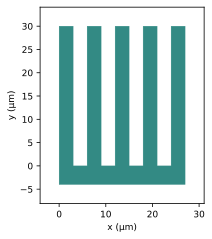

GDS stores every coordinate as an integer number of database units (DBU). In
this PDK 1 DBU is 1 nm, so every vertex you draw is rounded to a 1 nm grid
when it is stored. These three rules keep that rounding from changing a
conductor, a piece of metal that is meant to be electrically continuous: where
its parts meet, whether its outline is a valid polygon, and whether it is one
piece.

The examples on this page run on their own, in order, from the repository root
with `PYTHONPATH=tests` (for `geometry_checks`). They share this setup.

```python
import gdsfactory as gf
from orcapen_sc_pdk import activate

activate()
LAYER = (1, 0)


def box(x0, y0, x1, y1):
    return [(x0, y0), (x1, y0), (x1, y1), (x0, y1)]


def merged(component):
    """The layer as a mask writer sees it: overlapping polygons joined into one."""
    return component.get_region(LAYER, merge=True)
```

## R9. Keep every length and position on the 1 nm grid {#r9}

**Rule.** Every length and position you draw with is a whole number of
nanometres, so that two parts meant to meet land on the same grid point.

An off-grid value is rounded where it is used. A sum of off-grid values rounds
differently from the sum of the rounded values, so a part placed at
`pad_length + lead_length` and a lead that ends at `pad_length` plus its own
`lead_length` can miss each other by 1 nm. That gap splits the conductor in
two. The same cause left ten 1 nm slits between the IDC fingers and their
taper in the Purcell readout cell, whose finger length was 59.92476 µm
([#58](https://github.com/NCUPHY-LTLab/orcapen-sc-pdk/issues/58), A1).


```python
def pad_lead_pad(pad_length, lead_length):
    """A 10 µm pad, a 4 µm lead and a second pad, each placed at the sum of the lengths before it."""
    c = gf.Component()
    pad = gf.components.rectangle(size=(pad_length, 10), layer=LAYER)
    lead = gf.components.rectangle(size=(lead_length, 4), layer=LAYER)
    c << pad
    (c << lead).dmove((pad_length, 3))
    (c << pad).dmove((pad_length + lead_length, 0))
    return c


off_grid = pad_lead_pad(10.0004, 5.0004)
on_grid = pad_lead_pad(10.0, 5.0)
assert merged(off_grid).count() == 2  # the second pad is cut off by a 1 nm gap
assert merged(on_grid).count() == 1
```

**How to check.** A cell rejects an off-grid length or position parameter with
an error that names it ([R7](input-checks.md#r7c)).
`gf.snap.is_on_grid(value)` tells you whether a value is on the grid. The
construction checks then count the polygons of each conductor
([R8](construction-checks.md)).

```python
assert not gf.snap.is_on_grid(10.0004)
assert gf.snap.is_on_grid(10.0)
```

Values that come out of trigonometry or curve sampling are off the grid by
nature. They are not rejected; the rules on the following pages keep them from
splitting a conductor.

## R10. Draw every polygon valid: no self-intersection, no self-contact {#r10}

**Rule.** Every polygon's outline goes around once without crossing or touching
itself, and parts of one conductor overlap by a real width, never at a single
point.

Meshers and Boolean engines need valid polygons. Two parts of a conductor that
touch only at a corner merge into one outline that passes through the same
vertex twice, which is not a valid polygon. A point list in the wrong order
crosses itself. The `disk_flip_chip_qubit` ground outlines crossed themselves,
first at (−409.839, 423.274) µm on the control die and at (−500, 452.314) µm on
the qubit die ([#47](https://github.com/NCUPHY-LTLab/orcapen-sc-pdk/issues/47)).


```python
def two_pads(overlap):
    """Two 10 µm pads, the second shifted so that their corners overlap by `overlap` µm."""
    c = gf.Component()
    c.add_polygon(box(0, 0, 10, 10), layer=LAYER)
    c.add_polygon(box(10 - overlap, 10 - overlap, 20, 20), layer=LAYER)
    return c


touching = two_pads(0)
overlapping = two_pads(1)
```

**How to check.** `construction_report` from `tests/geometry_checks.py`
checks every drawn and every merged polygon with Shapely, a Python geometry
library, and names the defect and where it is
([R8](construction-checks.md)).

```python
from geometry_checks import construction_report  # tests/geometry_checks.py

assert "merged: Ring Self-intersection[10000 10000]" in construction_report(touching)[LAYER].defects
assert construction_report(overlapping)[LAYER].defects == ()
```

The report gives positions in DBU: `[10000 10000]` is (10, 10) µm.

## R11. Draw each conductor as one connected polygon of its own {#r11}

**Rule.** Each conductor is one polygon by its own construction, not only
after another part is added to it.

A part that relies on a neighbour to hold it together falls apart when the
neighbour moves, changes or is left out, and the merged layer then has more
pieces than conductors. The Purcell IDC comb had no connecting bar of its own:
its fingers joined only through zero-width segments and relied on the taper
to connect them ([#58](https://github.com/NCUPHY-LTLab/orcapen-sc-pdk/issues/58),
A1). The fix gave each comb a spine.




```python
def comb(spine):
    """Five 3 µm fingers at a 6 µm pitch, 30 µm long, with or without a spine under them."""
    c = gf.Component()
    for finger in range(5):
        c.add_polygon(box(6 * finger, 0, 6 * finger + 3, 30), layer=LAYER)
    if spine:
        c.add_polygon(box(0, -4, 27, 0), layer=LAYER)
    return c


assert merged(comb(spine=False)).count() == 5
assert merged(comb(spine=True)).count() == 1
```

**How to check.** Build the conductor on its own and count its merged
polygons, or pass the number of conductors per layer to `construction_report`
([R8](construction-checks.md)).

```python
report = construction_report(comb(spine=False), conductors={LAYER: 1})[LAYER]
assert "merged: 5 polygons for 1 conductor(s)" in report.defects
assert construction_report(comb(spine=True), conductors={LAYER: 1})[LAYER].defects == ()
```
