A cell is correct when its polygons are the shapes you meant to draw. The
construction rules below say how to build geometry so that it is, and how to
check it. Each rule comes from a failure measured in this PDK's cells, and
reviewers check a cell against them. Start with
[What is a cell](what-is-a-cell.md) for what becomes a cell and what you build
it from.

Each rule page has the same form: the rule in one sentence, a figure of the
problem, a figure of the result, an example that runs on its own, and how to
check it. The thumbnails show each problem.

## Terms

- **DBU** (database unit): the integer grid that GDS stores coordinates on. In
  this PDK 1 DBU is 1 nm, so every vertex is rounded to a 1 nm grid.
- **Local frame**: the coordinate system of the cell you draw a shape in,
  before any rotation, mirror or move places it in its parent.
- **Merge**: joining overlapping and touching polygons of a layer into the
  fewest polygons, as a mask writer does:
  `component.get_region(layer, merge=True)`.
- **Hole**: an enclosed gap in a merged polygon. GDS cannot store holes, so a
  writer joins each one to the outline with a cut line.
- **Sagitta**: the largest distance between a chord of a sampled curve and the
  arc it stands for.
- **Conductor**: one piece of metal that is meant to be electrically
  continuous, such as a pad with its lead.
- **XOR**: the area where two shapes differ.

## The rules

| Problem | Rule | In one line |
|---|---|---|
| 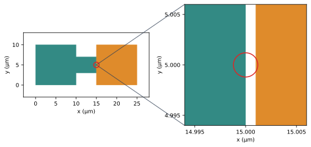{width=150} | [R9](grid-and-polygons.md#r9) | Keep every length and position on the 1 nm grid. |
| 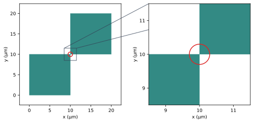{width=150} | [R10](grid-and-polygons.md#r10) | Draw every polygon valid: no self-intersection, no self-contact. |
| 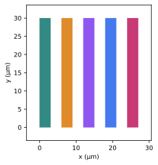{width=150} | [R11](grid-and-polygons.md#r11) | Draw each conductor as one connected polygon of its own. |
| 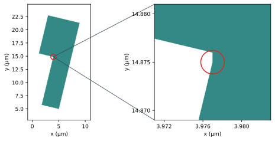{width=150} | [R1](one-outline.md#r1) | Merge the parts of a rigid shape in its local frame, then rotate and move it once. |
| 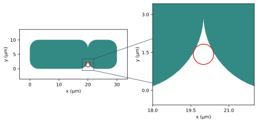{width=150} | [R6](one-outline.md#r6) | Union the parts first, round once, and keep a square end by extending and clipping. |
| 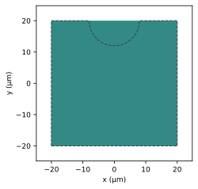{width=150} | [R12](one-outline.md#r12) | Combine shapes with Booleans, not by joining their point lists. |
| 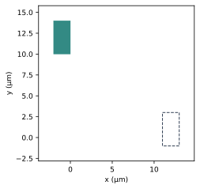{width=150} | [R2](placement.md#r2) | Turn a part in place about its centre; place it on a circle on purpose. |
| | [R3](placement.md#r3) | Transform references, never a shared cell (a note: GDSFactory enforces it). |
| 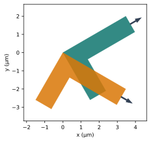{width=150} | [R4](placement.md#r4) | Mirror and rotate do not commute: connect a mirrored part to its port. |
| 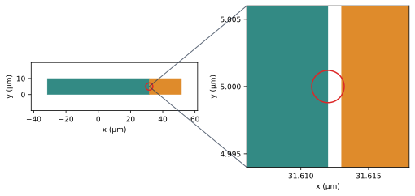{width=150} | [R13](placement.md#r13) | Join parts at their ports with `connect`, in the local frame. |
| 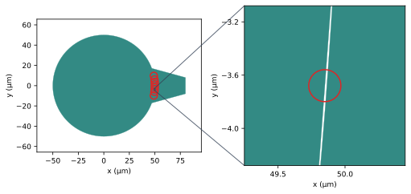{width=150} | [R5](curves.md#r5) | Where a straight edge meets a curve, run the edge into the body. |
| 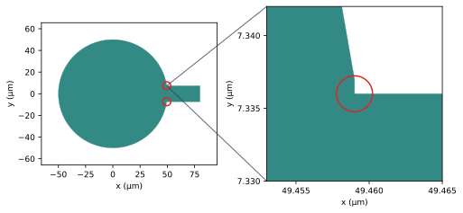{width=150} | [R14](curves.md#r14) | Where a straight edge or cut crosses a sampled curve, give both one shared vertex. |
| 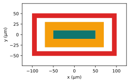{width=150} | [R15](companion-layers.md#r15) | Draw the mask from the metal's source and derive the etch from both. |
| 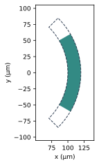{width=150} | [R7](input-checks.md) | Fix the construction first; reject what it cannot draw, and off-grid inputs; never hide a symptom. |
| 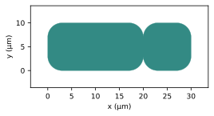{width=150} | [R8](construction-checks.md) | Run the construction checks on every build the cell supports. |

R1 to R8 keep their original numbers and R9 to R15 were added later, so the
table lists the rules in reading order rather than by number.

The construction checks are one of three kinds of check, each with its own
owner; see [Three kinds of check, and process rules](checks-and-process-rules.md).
