A cell is correct when its polygons are the shapes you meant to draw. The
construction rules below say how to build geometry so that it is, and how to
check it. Each rule comes from a failure measured in this PDK's cells, and
reviewers check a cell against them. Start with
[What is a cell](what-is-a-cell.md) for what becomes a cell and what you build
it from.

Each rule page has the same form: the rule in one sentence, a figure of the
problem, a figure of the result, an example that runs on its own, and how to
check it. The thumbnails show each problem.

## Reading the figures

- Each merged polygon has its own colour (teal, then amber, violet, blue and
  pink), so a conductor that fell apart shows as two colours.
- Red marks a defect: a circle around it, or a red area where two shapes
  differ.
- A dashed outline is a shape for comparison: the intended shape, or where a
  part started.
- An arrow is a port, pointing the way it faces.
- The panel on the right, where there is one, zooms on the defect; the result
  figure zooms on the same place.
- Layer colours are teal `DRAW`, grey `GROUND_MASK` and amber `ETCH`. A layer
  figure either has one panel per layer or, when the layers share one panel, a
  legend that names them; there the colours mean layers, not separate
  polygons.

## Terms

- **DBU** (database unit): the integer grid that GDS stores coordinates on. In
  this PDK 1 DBU is 1 nm, so every vertex is rounded to a 1 nm grid.
- **Local frame**: the coordinate system of the cell you draw a shape in,
  before any rotation, mirror or move places it in its parent.
- **Merge**: joining overlapping and touching polygons of a layer into the
  fewest polygons, as a mask writer does:
  `component.get_region(layer, merge=True)`.
- **Hole**: an enclosed gap in a merged polygon. GDS cannot store holes, so a
  writer joins each one to the outline with a cut line.
- **Sagitta**: the largest distance between a chord of a sampled curve and the
  arc it stands for.
- **Conductor**: one piece of metal that is meant to be electrically
  continuous, such as a pad with its lead.
- **XOR**: the parts of two shapes that do not overlap, that is, where they
  differ.

## The rules

| Problem | Rule | In one line |
|---|---|---|
| 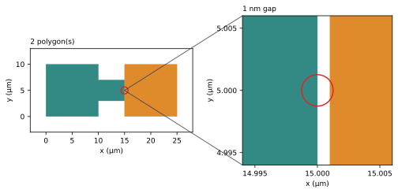{width=150} | [R1](grid-and-polygons.md#r1) | Keep every length and position on the 1 nm grid. |
| 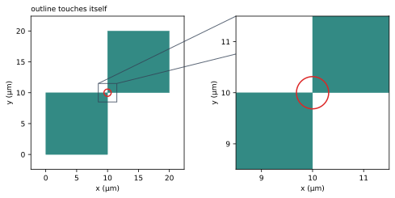{width=150} | [R2](grid-and-polygons.md#r2) | Draw every polygon valid: no self-intersection, no self-contact. |
| 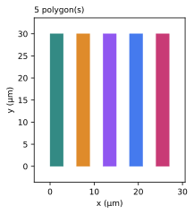{width=150} | [R3](grid-and-polygons.md#r3) | Draw each conductor as one connected polygon of its own. |
| 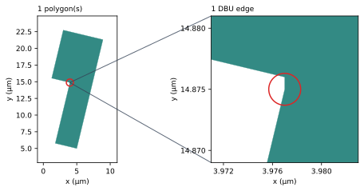{width=150} | [R4](one-outline.md#r4) | Merge the parts of a rigid shape in its local frame, then rotate and move it once. |
| 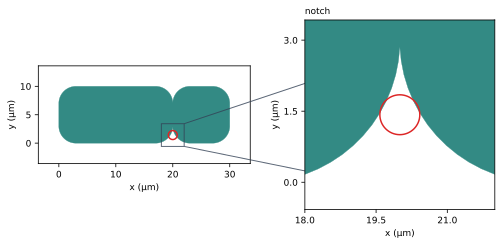{width=150} | [R5](one-outline.md#r5) | Round a conductor once, after all of its parts are joined. |
| 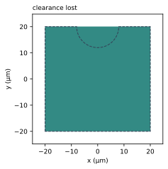{width=150} | [R6](one-outline.md#r6) | Combine shapes with Booleans, not by joining their point lists. |
| 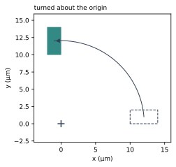{width=150} | [R7](placement.md#r7) | Turn a part about its own centre; to place it on a circle, turn it at the origin and move it out. |
| | [R8](placement.md#r8) | Transform references, never a shared cell (a note: GDSFactory enforces it). |
| 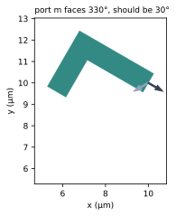{width=150} | [R9](placement.md#r9) | Place a mirrored part with `connect(..., mirror=True)`. |
| 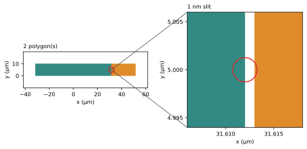{width=150} | [R10](placement.md#r10) | Join parts with `connect` at 0°, 90°, 180° or 270°, then rotate the merged result. |
| 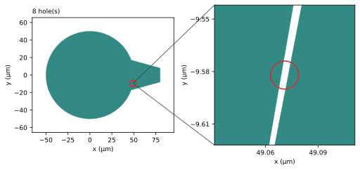{width=150} | [R11](curves.md#r11) | Where a straight edge meets a curve, run the edge into the body. |
| 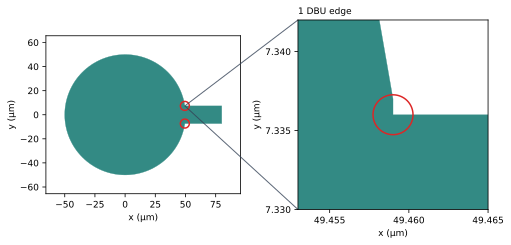{width=150} | [R12](curves.md#r12) | Where a straight edge or cut crosses a sampled curve, give both one shared vertex. |
| 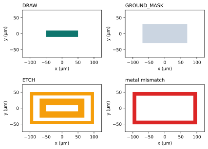{width=150} | [R13](companion-layers.md#r13) | Derive the etch from a mask drawn with the metal. |
| {width=150} | [R14](input-checks.md#r14) | Fix the construction before you limit an input. |
| 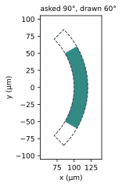{width=150} | [R15](input-checks.md#r15) | Reject a value the construction cannot draw; never clamp it. |
| {width=150} | [R16](input-checks.md#r16) | Reject off-grid inputs. |
| 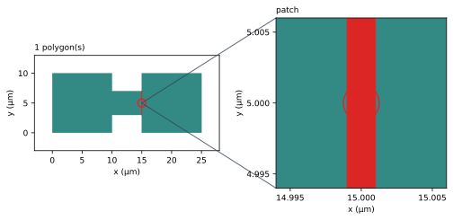{width=150} | [R17](input-checks.md#r17) | Fix the cause of a defect instead of patching over it. |
| 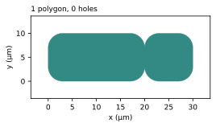{width=150} | [R18](construction-checks.md#r18) | Run `construction_report` on every build the cell supports. |

The construction checks are one of three kinds of check, each with its own
owner; see [Three kinds of check, and process rules](checks-and-process-rules.md).
