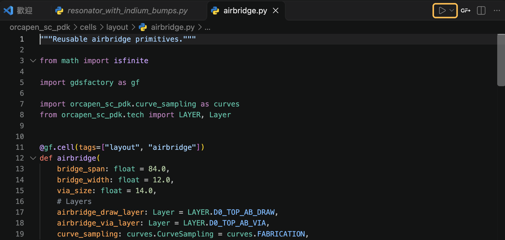
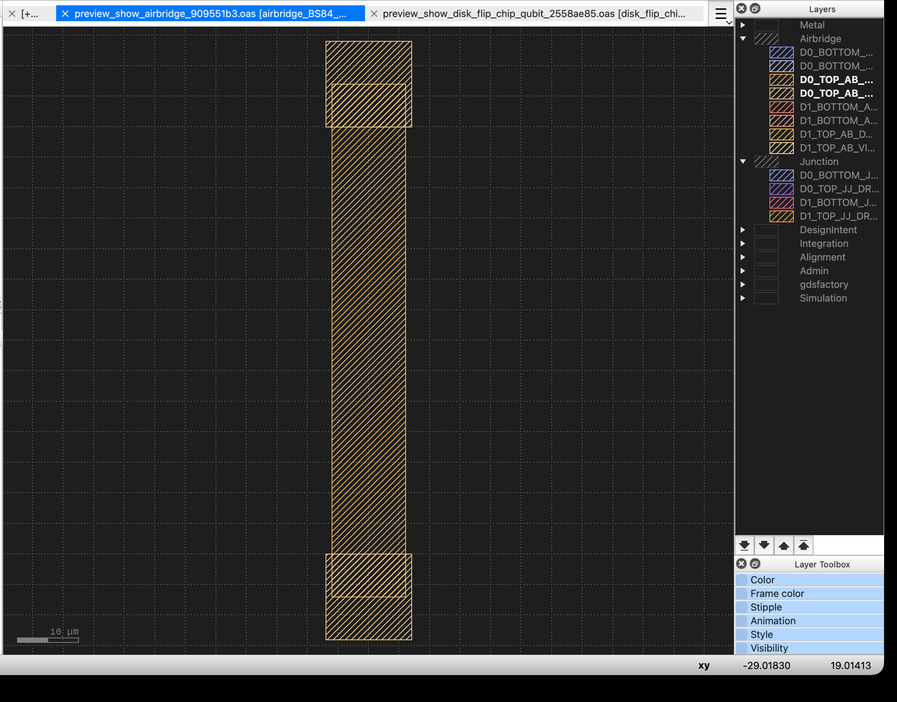

Contribute reusable cells, process records, examples, or documentation through
the [public repository](https://github.com/NCUPHY-LTLab/orcapen-sc-pdk).
Start with the part of the PDK your change affects.

## Set up a development checkout

```bash
git clone https://github.com/NCUPHY-LTLab/orcapen-sc-pdk.git
cd orcapen-sc-pdk
uv sync -p 3.12
```

This installs the PDK plus the development tools, pytest and Ruff. Then set up
the viewer you use. GDSFactory+ is optional and needs a paid subscription.

**Without GDSFactory+**: install [KLayout](https://www.klayout.de/). In KLayout,
choose **Tools → Manage Packages**, then search for and install **klive**.
Keep KLayout open while running `component.show()` to display or refresh the
layout directly. See the [GDSFactory KLayout integration guide](https://gdsfactory.github.io/gdsfactory/notebooks/_2_klayout/)
and [View layers in KLayout](start/layers.qmd#view-layers-in-klayout) to apply
OrcaPen layer names and colors.

**With GDSFactory+**: open the checkout in VS Code with the GDSFactory+
extension (version 2.3 or later) and choose **Setup Automatically** in
**GF+ Settings → Status**. The extension installs its SDK and the packages its
worker needs, including the SPICE packages InSpice and vacask, into `.venv`.
GDSFactory+ requires Python 3.12.

- These packages are not in `uv.lock`, so a later `uv sync` removes them.
  Choose **Setup Automatically** again to reinstall them.
- The extension also adds a `[tool.uv]` block marked "Managed by GDSFactory+"
  to `pyproject.toml` and updates `uv.lock`. Keep those edits local and leave
  them out of commits: they limit the lock file to Linux x86-64 for everyone.

Check: `uv run python --version` reports a supported Python version.
For documentation dependencies and preview, use
[Documentation & Website](docs-publishing.md).

## Preview a component

### Run a cell file from VS Code and view it in KLayout

Install **klive** in KLayout and install the OrcaPen KLayout technology once
from the checkout:

```bash
uv run python -m orcapen_sc_pdk.install_tech
```

Restart KLayout after installing the technology and leave it open. In VS Code,
open the OrcaPen checkout with the [Microsoft Python extension](https://marketplace.visualstudio.com/items?itemName=ms-python.python)
installed. Run **Python: Select Interpreter** from the Command Palette and choose
the project's `.venv` created by `uv sync`.

> **Set the KLayout canvas before previewing.** OrcaPen's tutorial uses a near-black
> canvas (`#1E1E1E`), matching the dark background used for the layer palette.
> Open **klayout → Preferences…** on macOS or **File → Setup** on other
> platforms. Choose **Display → Background**, set **Background color** to
> `#1E1E1E` (RGB 30, 30, 30), and click **Apply**. This is the layout canvas
> setting. The OrcaPen technology supplies the layer colors and groups.

1. Open `orcapen_sc_pdk/cells/layout/airbridge.py`.
2. Click **Run Python File** (▶) at the top right of the editor. The Python
   extension runs the file and its `if __name__ == "__main__":` preview block.

   

3. Switch to KLayout. KLive opens or refreshes the airbridge layout and selects
   the `orcapen_sc_pdk` technology for that layout. Expand **Airbridge** in the
   Layers panel to see its draw and via layers. If the live connection is
   unavailable, open `build/gds/airbridge.gds` in KLayout with the OrcaPen
   technology selected.

   

A file containing several cell factories previews the one selected by its
`__main__` block. To run a file from the terminal:

```bash
uv run python orcapen_sc_pdk/cells/layout/airbridge.py
```

To preview any registered cell by name:

```bash
uv run python -m orcapen_sc_pdk.preview resonator
```

Both write `build/gds/<cell>.gds` and open it. Inside a VS Code terminal with
GDSFactory+ installed, the file opens in the GDSFactory+ Layout Viewer.
Otherwise it is sent to KLayout through klive. Pass `--viewer klayout` or
`--viewer gdsfactoryplus` to choose explicitly. In a new cell module, end with
the same block:

```python
if __name__ == "__main__":
    # Imported here because orcapen_sc_pdk.pdk imports this module.
    from orcapen_sc_pdk.preview import show

    show(my_cell)
```

## Keep changes focused

- Put reusable layout and process definitions in OrcaPen.
- Reuse GDSFactory for component composition and routing.
- Decorate cells with plain `@gf.cell`, the only form GDSFactory+ discovers. A
  cell with curves takes `curve_sampling: CurveSampling = FABRICATION` and passes it
  to nested cells and curve helpers; see [Curve sampling](usage/curve-sampling.md).
- Use SCGSim for simulation preparation, solver integration, and returned results.
- Keep private layouts, parameters, and run directories in the consuming project.

Inspect the relevant existing source and examples before introducing a new
interface. Keep the related documentation next to the public behavior it describes.

## Submit a change

Describe the behavior changed, the affected public interfaces, and the checks
you ran in a pull request. Keep saved scientific results associated with their
original model and runtime; editing a tutorial does not rerun it.

See [Workspace & Related Packages](home/ecosystem-workspace.md) for package roles,
[SCGSim integration](features/scgsim-integration.md) for the source/runtime boundary,
and [Documentation & Website](docs-publishing.md) for notebook pairing and deployment.
