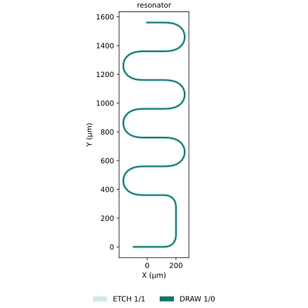

Install the public source revision below, activate OrcaPen, and build a registered
cell. Layout use needs neither Palace nor an AEDT installation.

## Install

Use Python 3.12 or 3.13 in your project environment. For a new project,
initialize a uv project with `uv init --python 3.12` (or `--python 3.13`), then
add the public source revision:

```bash
uv add "orcapen-sc-pdk @ git+https://github.com/NCUPHY-LTLab/orcapen-sc-pdk.git@aee7f8b848895f2d107f6b086310e866e8381f73"
uv run python -c "import importlib.metadata as m; print(m.version('orcapen-sc-pdk'))"
```

Check: the version command reports `0.1.0.dev2`.
The package selects GDSFactory `~=9.48.0` and its other layout dependencies.

## Activate and see a cell

In a Jupyter notebook or Python script, use:

```python
import gdsfactory as gf
import matplotlib.pyplot as plt
from orcapen_sc_pdk import activate

activate()
component = gf.get_component("resonator")
print(component.name)
print(component.dbbox())
component.plot()
plt.show()
```

Check: the cell name and physical bounding box are printed, and a 2D layout
appears in the notebook output or a plot window. Lengths and physical port
dimensions use micrometres.

For a script, save the example as `example.py` and run:

```bash
uv run example.py
```

{width=80%}

## Choose your next step

| Task | Guide |
| --- | --- |
| Pick a capacitor, resonator, launcher, or primitive | [Cells](public-pdk-examples/index.md) |
| Select geometry layers and physical heights | [Layers & Stack](start/layers.qmd) |
| Choose bulk materials or surface-interface assumptions | [Materials & Interfaces](start/materials.qmd) |
| Select a CPW section and inspect layout interfaces | [Cross-sections](public-pdk-examples/cross-sections.qmd) |
| Place, connect, route, or export a layout | [GDSFactory and OrcaPen](public-pdk-examples/component-authoring.md) |
| Calculate a physical quantity | [Choose a Simulation](notebooks.qmd) |

Simulation examples have their own SCGSim and solver prerequisites. Read the
selected tutorial's setup before installing optional simulation dependencies.
