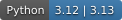

[](getting-started.md)
[](https://github.com/NCUPHY-LTLab/orcapen-sc-pdk/blob/71d60ca03831580866cac139e337146fdb17a66c/LICENSE)
[](home/versions.md)

{fig-alt="An orca and penguin accompany a stylized superconducting chip and layer stack."}

OrcaPen is a GDSFactory PDK for superconducting quantum and RF circuits. It pairs named layout layers with physical stacks, and provides public components for electromagnetic and circuit-model examples.

## Layers and physical stacks

Layer names identify the die, face and metal level, making it easier to connect layouts with 3D integration and layout simulation. For example, `D0_TOP_M1_DRAW` identifies the top-face M1 drawing layer on die D0; `D0_D1_INDIUM_BUMP` identifies an interconnect between the two dies.

The following definitions are excerpted directly from [`tech.py`](https://github.com/NCUPHY-LTLab/orcapen-sc-pdk/blob/71d60ca03831580866cac139e337146fdb17a66c/orcapen_sc_pdk/tech.py):

```python

```

The layer stack supplies height, thickness, material and simulation attributes for these layers. The default D0 top-face M1 starts at z = 0 and is 0.1 µm thick. Single-die and two-die flip-chip stacks are available, with separate airbridge and indium-bump levels. See [Layers & Stack](start/layers.qmd) and [Materials & Interfaces](start/materials.qmd).

## Public components for SCGSim and SCNSim

:::: {.askr-card}
::: {.askr-card-body}
### [Public test components and simulation examples](notebooks.qmd) {.askr-card-title .unlisted}

Use a common public specimen to connect a layout question with an electromagnetic or circuit-model question. OrcaPen supplies the component geometry and stack; [SCGSim](https://ncuphy-ltlab.github.io/scgsim/) handles electromagnetic modeling and extraction, while [SCNSim](https://ncuphy-ltlab.github.io/scnsim/) provides circuit-network modeling and response analysis.
:::
::::

## Install

For a new project, use the commands below with Python 3.12. Python 3.13 is also supported; in an existing uv project, start at `uv add`.



Check: the version command reports `1.0.0` after the source tag is published.

[Activate OrcaPen and view a cell](getting-started.md#activate-and-see-a-cell), inspect the [common cells](start/common-cells.qmd), or explore the [CPW cross-sections](public-pdk-examples/cross-sections.qmd). Component settings and port definitions are listed in the [API reference](api.qmd).
