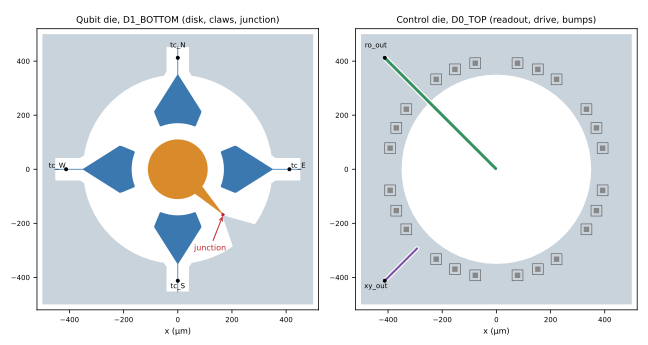

`disk_flip_chip_qubit` builds a two-die flip-chip transmon site, centred at the
origin in a 1000 × 1000 µm square. A disk island on the qubit die connects to
the surrounding ground through one Manhattan junction. Four optional arc claws
couple to the disk, and the readout and drive lines sit on the control die.
The defaults are a layout preset, not a measured or qualified device.

## Build the default component

```python
import gdsfactory as gf
from orcapen_sc_pdk import activate

activate()
grounded = gf.get_component("disk_flip_chip_qubit")
floating = gf.get_component("disk_flip_chip_qubit", tc_grounded_sides=())
disk_only = gf.get_component("disk_flip_chip_qubit", include_tc=False)
```



## Geometry

| Feature | Arguments | Default |
| --- | --- | --- |
| Disk island radius | `disk_radius` | `None`: 110.5 µm with all four claws grounded, 119.839 µm with none; give it explicitly for a mixed set |
| Ground clearance on both dies | `ground_clearance_diameter` | 700 µm circle |
| Site square, half side | `ground_outer_half_extent` | 500 µm |
| Claws at N, E, S, W | `include_tc` | present |
| Claws shorted to ground | `tc_grounded_sides` | all four, `("N", "E", "S", "W")` |
| Claw-to-disk gap | `tc_disk_gap`, per side `tc_disk_gap_by_side` | 60 µm, e.g. `(("E", 40.0),)` |
| Claw radial width and body span | `tc_width`, `tc_span` | 60 µm, 45° |
| Claw taper landing span | `tc_landing_span` | 45°; `None` drops the taper |
| Claw CPW centre width and gap | `tc_cpw_width`, `tc_cpw_gap` | 3 µm, 40 µm |
| Optional claw CPW extension | `tc_outer_extension_start_radius`, `_width`, `_gap`, `_end_clearance` | off |
| Port square, half side | `handoff_half_extent` | 412.314 µm |
| Junction angle and overlap radius | `junction_angle`, `junction_overlap_radius` | 315°, 237.5 µm |
| Junction lead taper span and width | `junction_lead_span`, `junction_lead_width` | 20°, 2 µm |
| Open lead pairs without a junction | `junction_open_lead_angles` | none; quarter turns from `junction_angle` |
| Readout line angle, tip radius, CPW | `ro_angle`, `ro_tip_radius`, `ro_cpw_width`, `ro_cpw_gap` | 135°, 0 µm, 7 µm, 6 µm |
| Drive line angle, tip radius, CPW | `xy_angle`, `xy_tip_radius`, `xy_cpw_width`, `xy_cpw_gap` | 225°, 412 µm, 4 µm, 6 µm |
| Bump ring | `bump_center_radius`, `bump_lattice_count`, `bump_skip_period` | 400 µm, 32 sites, every 4th empty (24 bumps) |
| Bump sizes | `indium_bump_size`, `under_bump_size` | 20 µm, 40 µm squares |

A grounded claw ends in a radial tail, one CPW width wide, that runs through
the end of its CPW clearance into the ground. A floating claw is an isolated
conductor. `curve_sampling` sets the sampling of every circle and arc;
`corner_rounding_points=None` takes the corner rounding from it as well.

### Supported adjustments

The cell supports small adjustments around the presets, not every
combination. Settings that would draw a plausible layout with a short or an
open raise `ValueError`:

- Each claw stays inside the ground clearance, and `tc_span` is at most 60°.
- With claws, `junction_angle` and `junction_open_lead_angles` lie on the
  diagonals (45° + k·90°), between the claws.
- For grounded claws, the mask end (`handoff_half_extent` plus
  `tc_cpw_gap`, or plus `tc_outer_extension_end_clearance`) plus one CPW
  width fits inside `ground_outer_half_extent`.
- Every bump clears the ground clearance and the readout, drive and claw
  masks by half the diagonal of its larger square (`indium_bump_size` or
  `under_bump_size`). Moving `ro_angle` or `xy_angle`, or changing
  `bump_lattice_count` or `bump_skip_period`, must keep the lines on empty
  bump sites.
- `junction_lead_width` stays below the 5.657 µm spacing of the two junction
  contacts, so the round lead caps do not meet.
- `ro_tip_radius` and `xy_tip_radius` leave at least half the CPW width of
  line before the handoff square.

The caller keeps anything else these rules do not cover, such as the readout
and drive lines staying clear of each other.

## Ports, layers and ground

| Port | Position | Width |
| --- | --- | --- |
| `tc_N`, `tc_E`, `tc_S`, `tc_W` | claw CPW ends on the port square, facing outward | `tc_cpw_width` |
| `ro_out` | readout line end at `ro_angle` on the port square | `ro_cpw_width` |
| `xy_out` | drive line end at `xy_angle` on the port square | `xy_cpw_width` |
| `o_junction_lumped` | lumped junction port on the simulation sheet across the junction | junction width |

The qubit die uses `D1_BOTTOM_M1_DRAW`, `D1_BOTTOM_GROUND_MASK` and
`D1_BOTTOM_JJ_DRAW`, with the junction's simulation sheet on
`D1_BOTTOM_SIM_BOUNDARY`. The control die uses `D0_TOP_M1_DRAW` and
`D0_TOP_GROUND_MASK`. Bumps use `D0_D1_INDIUM_BUMP` and `D0_D1_UNDER_BUMP`.

Signal conductors are the instances `QFace` (disk and junction), `TC_N`,
`TC_E`, `TC_S`, `TC_W`, `RO` and `XY`. Each die's ground lives in its own
instances: `QGround` and `CGround` hold the ground metal (site square minus
mask) and the die domain on `D1_SUBSTRATE_AREA` / `D0_SUBSTRATE_AREA`;
`QGroundMask` and `CGroundMask` hold the masks. To place several sites under
one common ground, build each site with `include_ground=False`, which leaves out
`QGround` and `CGround` and keeps the masks, then draw the ground in the parent
as the common area minus the masks.

## Sources and adaptations

- KQCircuits [`CircularTransmonSingleIsland`](https://iqm-finland.github.io/KQCircuits/api/kqcircuits.qubits.circular_transmon_single_island.html):
  a disk island in a circular clearance, one junction to ground, and arc
  couplers at a fixed radius. KQCircuits is GPL-3.0; it is cited as prior art
  only, and no KQCircuits code is used.
- J. Braumüller et al., *Concentric transmon qubit featuring fast tunability
  and an anisotropic magnetic dipole moment*,
  [Appl. Phys. Lett. 108, 032601 (2016)](https://doi.org/10.1063/1.4940230):
  circular island and circular clearance.
- S. Kosen et al., *Building blocks of a flip-chip integrated superconducting
  quantum processor*,
  [Quantum Sci. Technol. 7, 035018 (2022)](https://doi.org/10.1088/2058-9565/ac734b):
  qubit and control dies joined by indium bumps, readout and drive on the
  control die.

OrcaPen's adaptations combine these patterns: four claws that taper to CPWs
and can be grounded, tapered junction leads on both sides, and readout and
drive tips on the control die. They do not come from a single paper.

See the [public source](https://github.com/NCUPHY-LTLab/orcapen-sc-pdk/blob/develop/orcapen_sc_pdk/cells/layout/disk_qubit.py).
