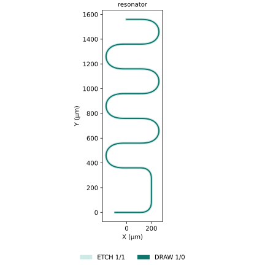

`resonator` combines a CPW hanger and meander, with optional tail and qubit
segment geometry. The `length` parameter is the target for the complete
centerline, not just the meander; the meander uses the length left after the
other sections are accounted for. The CPW cross-section selected by `cpw_xs`
defines the trace and gap geometry used by routed sections.

## Build the default component

```python
import gdsfactory as gf
from orcapen_sc_pdk import activate

activate()
component = gf.get_component("resonator")
```

## Parameters

| Argument | Default | Meaning |
| --- | --- | --- |
| `length` | 4000 µm | Full resonator centerline target. |
| `meanders` | 6 | Meander turns. |
| `coupling_length` | 200 µm | Hanger coupling section length. |
| `hanger_straight_length` | 160 µm | Hanger straight length. |
| `cpw_xs` | `cpw_6_10_6` | CPW cross-section. |
| `cpw_radius` | 100 µm | Bend radius used by the CPW sections. |
| `open_end` | `True` | Adds open-end termination geometry instead of a generic CPW route port. |

## Ports and layers

`o1` marks the hanger start, `o_hanger_center` is a placement anchor, and
`o_hanger_end` joins the meander. The component also provides readout coupling
anchors. These layout anchors locate or join geometry; they are not by
themselves electromagnetic solver terminals. DRAW, ETCH, and GROUND_MASK layers
are configurable. The default layout preview is in the [Cells gallery](../index.md#components-layout).



See the [generated API reference](../../reference/cells.resonator.qmd#orcapen_sc_pdk.cells.resonator)
and [pinned public source](https://github.com/NCUPHY-LTLab/orcapen-sc-pdk/blob/0bd9a9e1e8e21d6519f22373f20ef5ce22772a5b/orcapen_sc_pdk/cells/layout/resonator.py).
