Choose a registered cross-section to define the widths, transverse offsets,
layers, and connection ports extruded along a path. Open a name below for its
default preview, settings, and exact section layers.

| Registry name | Default recipe |
| --- | --- |
| [coplanar_waveguide](#coplanar_waveguide) | CPW: width 10 µm / gaps 6 µm |
| [coupled_cpw_w7_s6_d3](#coupled_cpw_w7_s6_d3) | Two 7 µm traces / 6 µm slots / 3 µm ground strip |
| [cpw](#cpw) | Alias: coplanar_waveguide |
| [cpw_2dot7_4_2dot7](#cpw_2dot7_4_2dot7) | CPW: width 4 µm / gaps 2.7 µm |
| [cpw_6_7_6](#cpw_6_7_6) | CPW: width 7 µm / gaps 6 µm |
| [cpw_6_10_6](#cpw_6_10_6) | CPW: width 10 µm / fixed gaps 6 µm |
| [cpw_15_5_15](#cpw_15_5_15) | D1 BOTTOM CPW: width 5 µm / gaps 15 µm |
| [n_trace_coplanar_waveguide](#n_trace_coplanar_waveguide) | Parameterized multi-trace CPW; default W7/S6/D3 |
| [etch](#etch) | Etch-only CPW-shaped mask |
| [etch_only](#etch_only) | Alias: etch |
| [josephson_junction_cross_section_narrow](#josephson_junction_cross_section_narrow) | JJ drawing wire: width 0.09 µm |
| [josephson_junction_cross_section_wide](#josephson_junction_cross_section_wide) | JJ drawing wire: width 0.2 µm |
| [launcher_cross_section_big](#launcher_cross_section_big) | Launcher CPW: width 200 µm / gaps 110 µm |
| [microstrip](#microstrip) | Additive strip: width 10 µm |
| [strip](#strip) | Alias: microstrip |
| [strip_metal](#strip_metal) | Alias: microstrip |

## Read the previews

Each preview uses the actual default section records returned by
`gf.get_cross_section(name)` with OrcaPen active and GDSFactory 9.48.0.
Recipes on M1 first show a transverse physical face cut: 0.1 µm Al and a
500 µm Si substrate, with exaggerated metal thickness and a cropped, broken
vertical scale. CPW slots and residual ground come from the section intervals;
outer ground continues beyond the illustration's crop, without a selected
finite width. Colors follow the existing `layers.yaml` entries.

The second panel shows the underlying XY recipe. Each horizontal bar spans
`offset − width/2` to `offset + width/2` in µm. Rows separate section records so
overlapping DRAW, ETCH, and GROUND_MASK recipes remain visible; **that panel's
vertical direction is not physical Z**. Each panel has its own horizontal scale.
ETCH-only and JJ entries show recipe panels only: ETCH draws removal masks,
while JJ drawing layers have no declared physical stack level.

Combine the recipe with [Layers & Stack](../start/layers.qmd) for Z and material.
D0 TOP M1 occupies z = 0..0.1 µm in Al above 500 µm Si; D1 BOTTOM M1 occupies
z = 8.1..8.2 µm with outward direction −Z. Ground masks and etch sections are
construction inputs, not extra metal films. No finite outer-ground width is
selected by these cross-sections.

Definitions live in
[tech.py](https://github.com/NCUPHY-LTLab/orcapen-sc-pdk/blob/c4dbf7a88166f5817ffbac5fc4182a7a429ae69b/orcapen_sc_pdk/tech.py#L678);
the 16 names are registered in
[pdk.py](https://github.com/NCUPHY-LTLab/orcapen-sc-pdk/blob/c4dbf7a88166f5817ffbac5fc4182a7a429ae69b/orcapen_sc_pdk/pdk.py#L113).
The default layer assignments appear in each table below. Bend radius is
routing metadata, not a bend drawn in the transverse preview.

## Registered cross-section previews

### coplanar_waveguide {#coplanar_waveguide}

Parameterized CPW: a 10 µm signal with a 6 µm slot on each side. The 22 µm ground mask bounds the slots; outer ground comes from the component's face/domain geometry.


Default settings: `width=10`; `gap=6`; `radius=100`. Returned bend radius: `100` µm.

Layers: `D0_TOP_M1_DRAW` `(1, 0)`; `D0_TOP_M1_ETCH` `(1, 1)`; `D0_TOP_GROUND_MASK` `(110, 0)`.

| Actual section | Width (µm) | Offset (µm) | GDS pair |
| --- | ---: | ---: | --- |
| `cpw_draw` | 10 | 0 | `(1, 0)` |
| `cpw_etch_neg` | 6 | -8 | `(1, 1)` |
| `cpw_etch_pos` | 6 | 8 | `(1, 1)` |
| `cpw_ground_mask` | 22 | 0 | `(110, 0)` |

### coupled_cpw_w7_s6_d3 {#coupled_cpw_w7_s6_d3}

Fixed two-trace recipe: each trace is 7 µm wide with a 6 µm slot on both sides. A 3 µm residual ground strip lies between the inner slots. Trace centres are at +11 and −11 µm; nearest trace edges are 15 µm apart, not 3 µm.

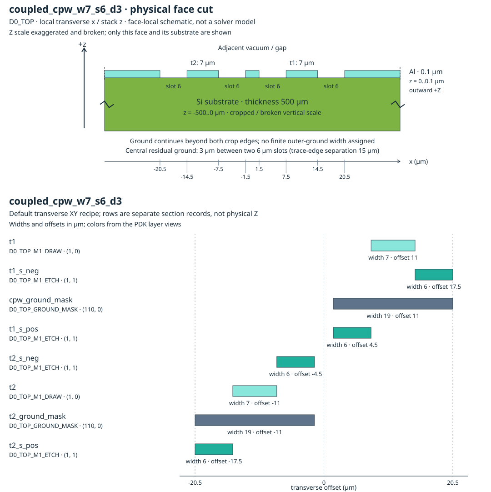

Default settings: `trace_names=None`; `radius=100`. Returned bend radius: `100` µm.

Layers: `D0_TOP_M1_DRAW` `(1, 0)`; `D0_TOP_M1_ETCH` `(1, 1)`; `D0_TOP_GROUND_MASK` `(110, 0)`.

| Actual section | Width (µm) | Offset (µm) | GDS pair |
| --- | ---: | ---: | --- |
| `t1` | 7 | 11 | `(1, 0)` |
| `t1_s_neg` | 6 | 17.5 | `(1, 1)` |
| `cpw_ground_mask` | 19 | 11 | `(110, 0)` |
| `t1_s_pos` | 6 | 4.5 | `(1, 1)` |
| `t2_s_neg` | 6 | -4.5 | `(1, 1)` |
| `t2` | 7 | -11 | `(1, 0)` |
| `t2_ground_mask` | 19 | -11 | `(110, 0)` |
| `t2_s_pos` | 6 | -17.5 | `(1, 1)` |

### cpw {#cpw}

Alias of [coplanar_waveguide](#coplanar_waveguide). It exposes the same parameters and returns the same default section geometry.

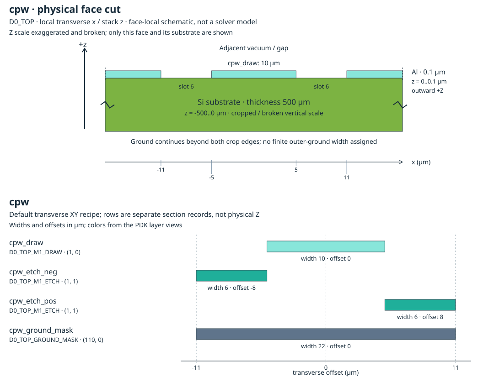

Default settings: `width=10`; `gap=6`; `radius=100`. Returned bend radius: `100` µm.

Layers: `D0_TOP_M1_DRAW` `(1, 0)`; `D0_TOP_M1_ETCH` `(1, 1)`; `D0_TOP_GROUND_MASK` `(110, 0)`.

| Actual section | Width (µm) | Offset (µm) | GDS pair |
| --- | ---: | ---: | --- |
| `cpw_draw` | 10 | 0 | `(1, 0)` |
| `cpw_etch_neg` | 6 | -8 | `(1, 1)` |
| `cpw_etch_pos` | 6 | 8 | `(1, 1)` |
| `cpw_ground_mask` | 22 | 0 | `(110, 0)` |

### cpw_2dot7_4_2dot7 {#cpw_2dot7_4_2dot7}

CPW with a 4 µm signal and fixed 2.7 µm slots. Changing width preserves the 2.7 µm gap; the default ground-mask width is 9.4 µm.

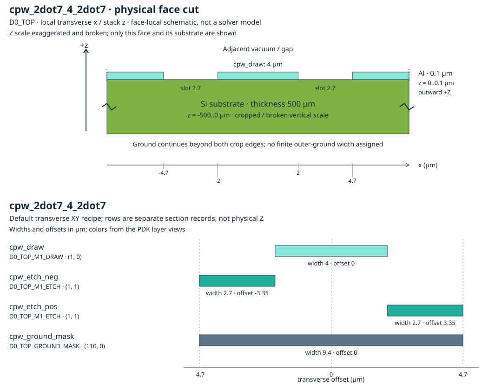

Default settings: `width=4`; `radius=100`. Returned bend radius: `100` µm.

Layers: `D0_TOP_M1_DRAW` `(1, 0)`; `D0_TOP_M1_ETCH` `(1, 1)`; `D0_TOP_GROUND_MASK` `(110, 0)`.

| Actual section | Width (µm) | Offset (µm) | GDS pair |
| --- | ---: | ---: | --- |
| `cpw_draw` | 4 | 0 | `(1, 0)` |
| `cpw_etch_neg` | 2.7 | -3.35 | `(1, 1)` |
| `cpw_etch_pos` | 2.7 | 3.35 | `(1, 1)` |
| `cpw_ground_mask` | 9.4 | 0 | `(110, 0)` |

### cpw_6_7_6 {#cpw_6_7_6}

CPW with a 7 µm signal and fixed 6 µm slots. Its default ground-mask width is 19 µm.

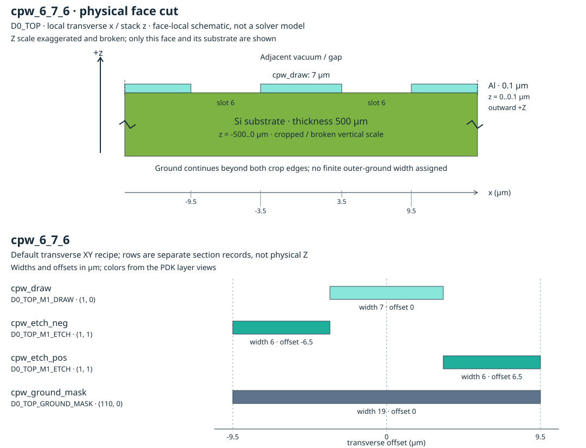

Default settings: `width=7`; `radius=100`. Returned bend radius: `100` µm.

Layers: `D0_TOP_M1_DRAW` `(1, 0)`; `D0_TOP_M1_ETCH` `(1, 1)`; `D0_TOP_GROUND_MASK` `(110, 0)`.

| Actual section | Width (µm) | Offset (µm) | GDS pair |
| --- | ---: | ---: | --- |
| `cpw_draw` | 7 | 0 | `(1, 0)` |
| `cpw_etch_neg` | 6 | -6.5 | `(1, 1)` |
| `cpw_etch_pos` | 6 | 6.5 | `(1, 1)` |
| `cpw_ground_mask` | 19 | 0 | `(110, 0)` |

### cpw_6_10_6 {#cpw_6_10_6}

CPW with a 10 µm signal and fixed 6 µm slots. Its default geometry matches coplanar_waveguide; this wrapper fixes the gap while exposing width.

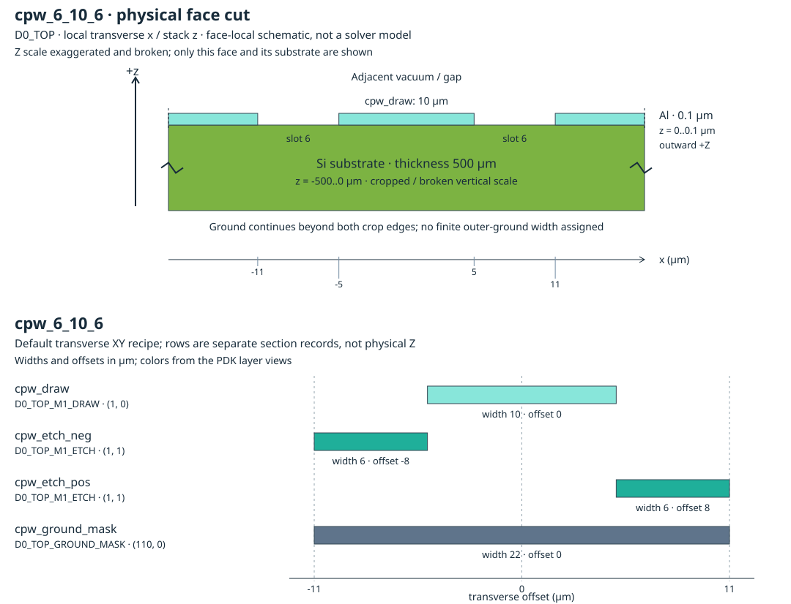

Default settings: `width=10`; `radius=100`. Returned bend radius: `100` µm.

Layers: `D0_TOP_M1_DRAW` `(1, 0)`; `D0_TOP_M1_ETCH` `(1, 1)`; `D0_TOP_GROUND_MASK` `(110, 0)`.

| Actual section | Width (µm) | Offset (µm) | GDS pair |
| --- | ---: | ---: | --- |
| `cpw_draw` | 10 | 0 | `(1, 0)` |
| `cpw_etch_neg` | 6 | -8 | `(1, 1)` |
| `cpw_etch_pos` | 6 | 8 | `(1, 1)` |
| `cpw_ground_mask` | 22 | 0 | `(110, 0)` |

### cpw_15_5_15 {#cpw_15_5_15}

CPW on **D1 BOTTOM**, with a 5 µm signal and 15 µm slots. Both width and gap are parameters. In the default physical stack, this face's 0.1 µm Al extends toward −Z from the substrate face at z = 8.2 µm, occupying z = 8.1..8.2 µm. The preview below shows XY recipe offsets, not a +Z extrusion.

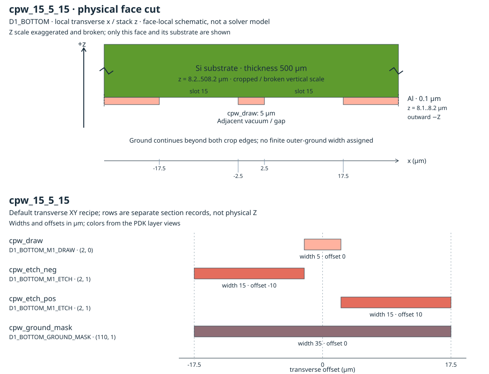

Default settings: `width=5`; `gap=15`; `radius=100`. Returned bend radius: `100` µm.

Layers: `D1_BOTTOM_M1_DRAW` `(2, 0)`; `D1_BOTTOM_M1_ETCH` `(2, 1)`; `D1_BOTTOM_GROUND_MASK` `(110, 1)`.

| Actual section | Width (µm) | Offset (µm) | GDS pair |
| --- | ---: | ---: | --- |
| `cpw_draw` | 5 | 0 | `(2, 0)` |
| `cpw_etch_neg` | 15 | -10 | `(2, 1)` |
| `cpw_etch_pos` | 15 | 10 | `(2, 1)` |
| `cpw_ground_mask` | 35 | 0 | `(110, 1)` |

### n_trace_coplanar_waveguide {#n_trace_coplanar_waveguide}

Parameterized multi-trace CPW. N traces take N widths, N per-trace gap values (one on each side of that trace), and N−1 inter-trace ground widths. The default two-trace geometry matches [coupled_cpw_w7_s6_d3](#coupled_cpw_w7_s6_d3).

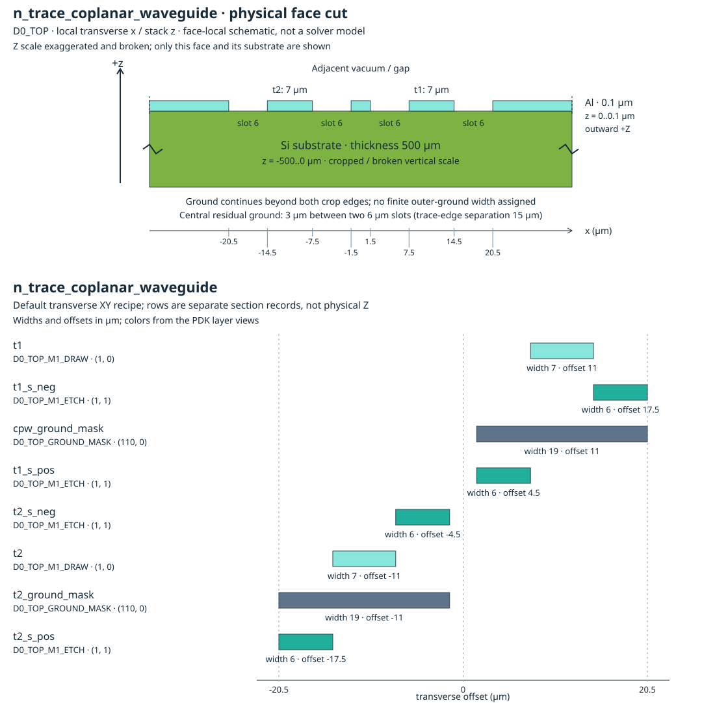

Default settings: `trace_widths=(7, 7)`; `trace_gaps=(6, 6)`; `inter_trace_ground_widths=(3,)`; `trace_names=None`; `radius=100`. Returned bend radius: `100` µm.

Layers: `D0_TOP_M1_DRAW` `(1, 0)`; `D0_TOP_M1_ETCH` `(1, 1)`; `D0_TOP_GROUND_MASK` `(110, 0)`.

| Actual section | Width (µm) | Offset (µm) | GDS pair |
| --- | ---: | ---: | --- |
| `t1` | 7 | 11 | `(1, 0)` |
| `t1_s_neg` | 6 | 17.5 | `(1, 1)` |
| `cpw_ground_mask` | 19 | 11 | `(110, 0)` |
| `t1_s_pos` | 6 | 4.5 | `(1, 1)` |
| `t2_s_neg` | 6 | -4.5 | `(1, 1)` |
| `t2` | 7 | -11 | `(1, 0)` |
| `t2_ground_mask` | 19 | -11 | `(110, 0)` |
| `t2_s_pos` | 6 | -17.5 | `(1, 1)` |

### etch {#etch}

Etch-only CPW-shaped recipe: all four sections, including the section named cpw_draw, use D0_TOP_M1_ETCH. Their union spans 22 µm. These are removal-mask polygons, not metal.

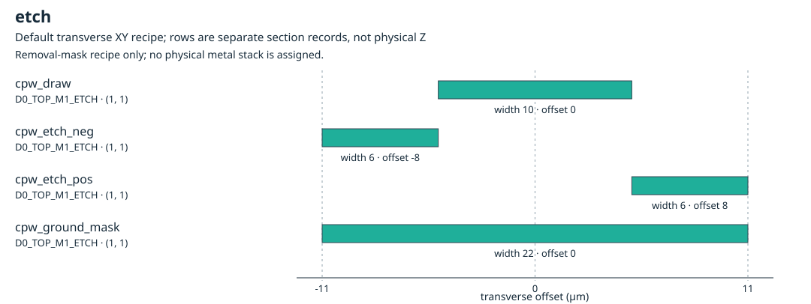

Default settings: `width=10`; `gap=6`; `radius=100`. Returned bend radius: `100` µm.

Layers: `D0_TOP_M1_ETCH` `(1, 1)`.

| Actual section | Width (µm) | Offset (µm) | GDS pair |
| --- | ---: | ---: | --- |
| `cpw_draw` | 10 | 0 | `(1, 1)` |
| `cpw_etch_neg` | 6 | -8 | `(1, 1)` |
| `cpw_etch_pos` | 6 | 8 | `(1, 1)` |
| `cpw_ground_mask` | 22 | 0 | `(1, 1)` |

### etch_only {#etch_only}

Alias of [etch](#etch), with the same partial-function defaults. All returned sections lie on ETCH; the section names do not turn them into conductors.

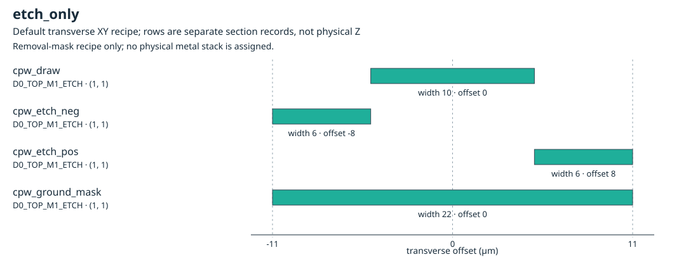

Default settings: `width=10`; `gap=6`; `radius=100`. Returned bend radius: `100` µm.

Layers: `D0_TOP_M1_ETCH` `(1, 1)`.

| Actual section | Width (µm) | Offset (µm) | GDS pair |
| --- | ---: | ---: | --- |
| `cpw_draw` | 10 | 0 | `(1, 1)` |
| `cpw_etch_neg` | 6 | -8 | `(1, 1)` |
| `cpw_etch_pos` | 6 | 8 | `(1, 1)` |
| `cpw_ground_mask` | 22 | 0 | `(1, 1)` |

### josephson_junction_cross_section_narrow {#josephson_junction_cross_section_narrow}

A 0.09 µm wire on D0_TOP_JJ_DRAW. This JJ drawing layer has no declared physical stack level, material, thickness, or Z interval; the preview is XY only.

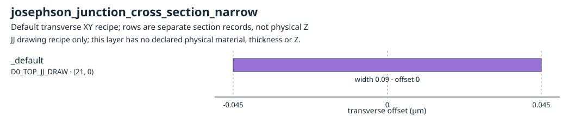

Default settings: no factory parameters. Returned bend radius: `10` µm.

Layers: `D0_TOP_JJ_DRAW` `(21, 0)`.

| Actual section | Width (µm) | Offset (µm) | GDS pair |
| --- | ---: | ---: | --- |
| `_default` | 0.09 | 0 | `(21, 0)` |

### josephson_junction_cross_section_wide {#josephson_junction_cross_section_wide}

A 0.2 µm wire on D0_TOP_JJ_DRAW. This JJ drawing layer has no declared physical stack level, material, thickness, or Z interval; the preview is XY only.

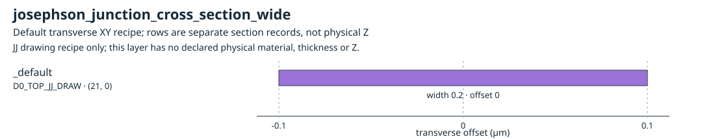

Default settings: no factory parameters. Returned bend radius: `10` µm.

Layers: `D0_TOP_JJ_DRAW` `(21, 0)`.

| Actual section | Width (µm) | Offset (µm) | GDS pair |
| --- | ---: | ---: | --- |
| `_default` | 0.2 | 0 | `(21, 0)` |

### launcher_cross_section_big {#launcher_cross_section_big}

Fixed launcher CPW: a 200 µm signal and 110 µm slots, with a 420 µm ground mask. The factory takes no parameters.

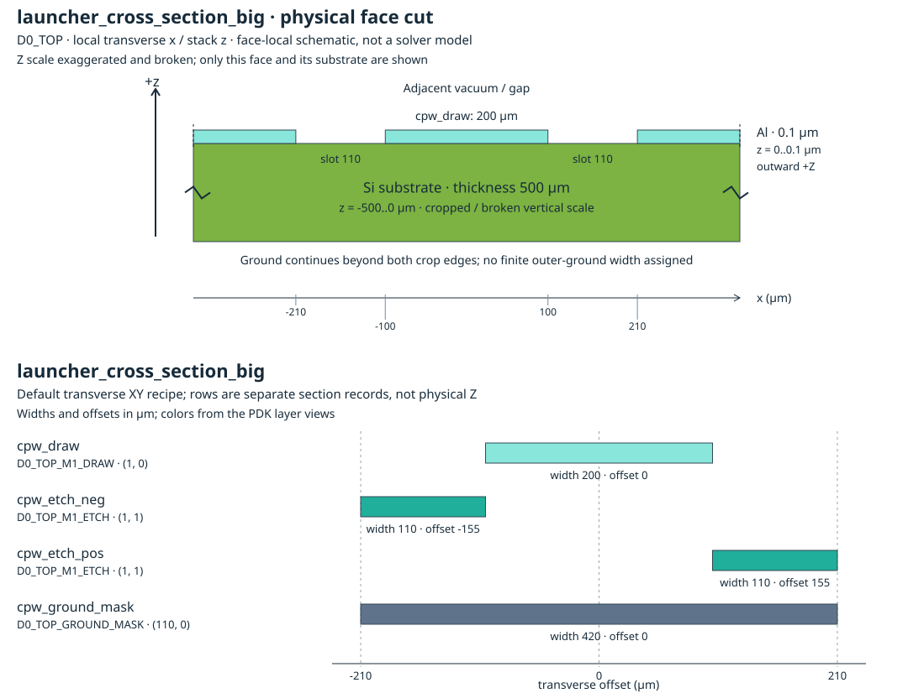

Default settings: no factory parameters. Returned bend radius: `100` µm.

Layers: `D0_TOP_M1_DRAW` `(1, 0)`; `D0_TOP_M1_ETCH` `(1, 1)`; `D0_TOP_GROUND_MASK` `(110, 0)`.

| Actual section | Width (µm) | Offset (µm) | GDS pair |
| --- | ---: | ---: | --- |
| `cpw_draw` | 200 | 0 | `(1, 0)` |
| `cpw_etch_neg` | 110 | -155 | `(1, 1)` |
| `cpw_etch_pos` | 110 | 155 | `(1, 1)` |
| `cpw_ground_mask` | 420 | 0 | `(110, 0)` |

### microstrip {#microstrip}

One additive 10 µm metal strip on D0_TOP_M1_DRAW. This recipe supplies no backside ground or complete ground-backed microstrip stack.


Default settings: `width=10`. Returned bend radius: `10` µm.

Layers: `D0_TOP_M1_DRAW` `(1, 0)`.

| Actual section | Width (µm) | Offset (µm) | GDS pair |
| --- | ---: | ---: | --- |
| `_default` | 10 | 0 | `(1, 0)` |

### strip {#strip}

Alias of [microstrip](#microstrip), with the same width/layer parameters and default additive strip. It adds no ground plane.

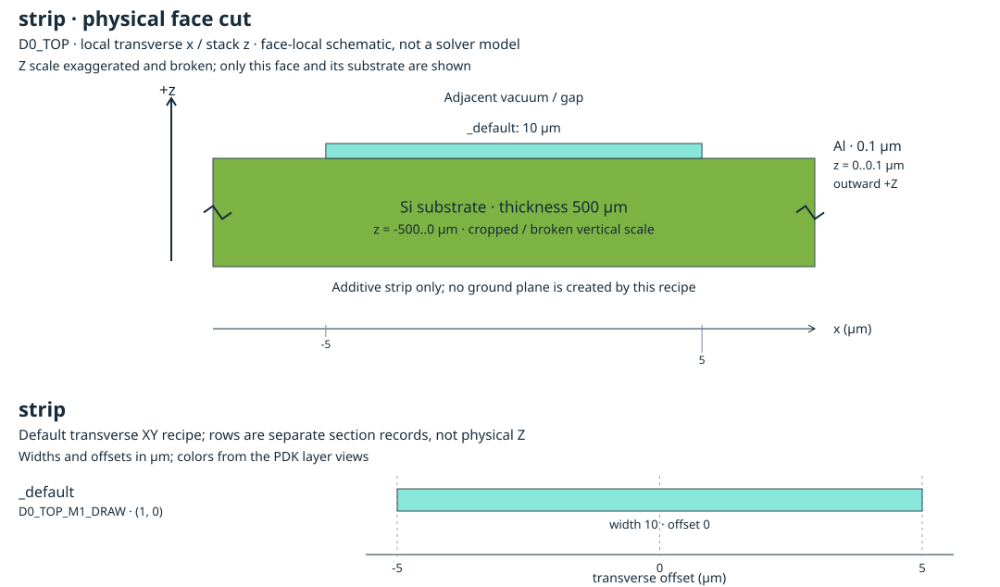

Default settings: `width=10`. Returned bend radius: `10` µm.

Layers: `D0_TOP_M1_DRAW` `(1, 0)`.

| Actual section | Width (µm) | Offset (µm) | GDS pair |
| --- | ---: | ---: | --- |
| `_default` | 10 | 0 | `(1, 0)` |

### strip_metal {#strip_metal}

Alias of [microstrip](#microstrip), with the same width/layer parameters and default additive strip. It adds no ground plane.

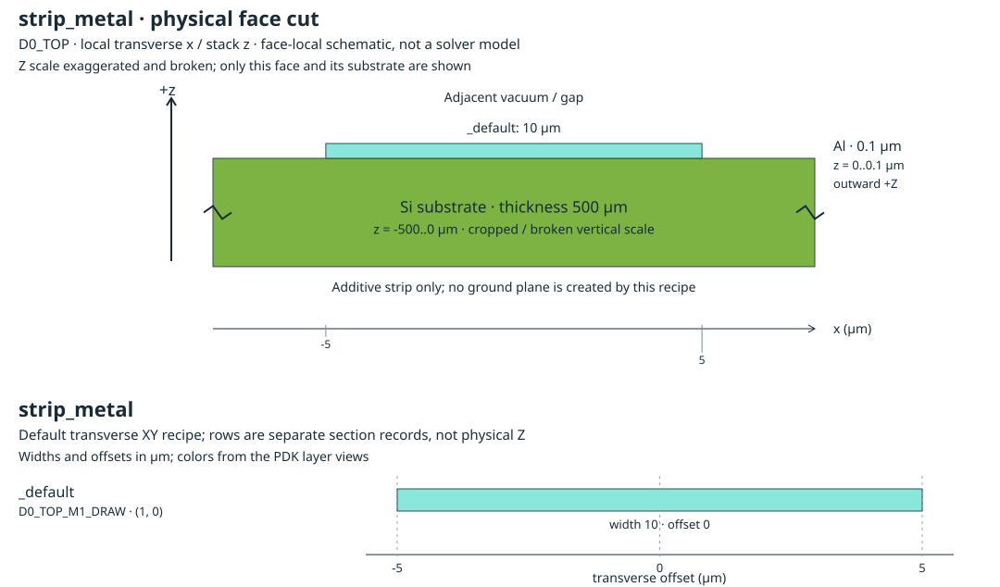

Default settings: `width=10`. Returned bend radius: `10` µm.

Layers: `D0_TOP_M1_DRAW` `(1, 0)`.

| Actual section | Width (µm) | Offset (µm) | GDS pair |
| --- | ---: | ---: | --- |
| `_default` | 10 | 0 | `(1, 0)` |

## Interpret the CPW ground recipe

For signal width `W` and gap `S`, the signal is `cpw_draw` at offset zero.
The two ETCH slots have width `S` and offsets `±(W + S)/2`; the
GROUND_MASK has width `W + 2S`. The component's face/domain recipe supplies
surrounding metal.

For multiple traces, the full span between outer slot edges is
`sum(trace_widths) + 2*sum(trace_gaps) + sum(inter_trace_ground_widths)`.
The default coupled recipe spans 41 µm. Its central 3 µm ground strip separates
two 6 µm inner slots; the signal centres are 22 µm apart.
Trace sections expose `<name>_o1` / `<name>_o2` ports.

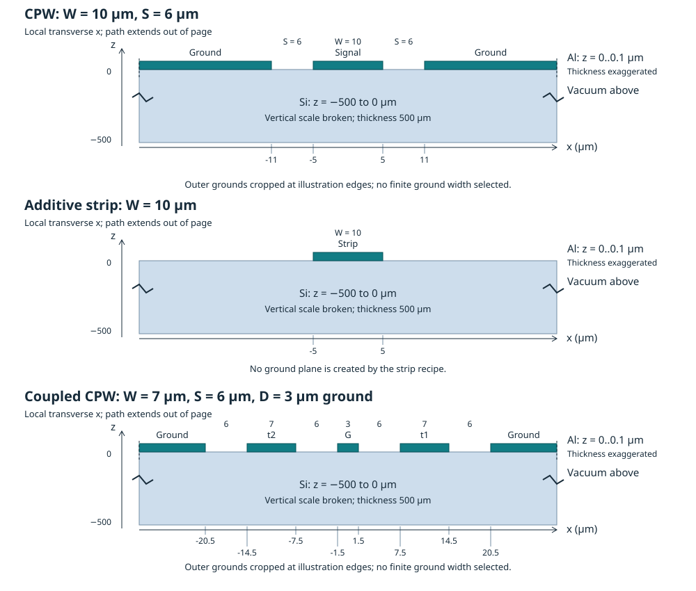

This physical schematic combines D0 TOP recipes with the single-die stack.
Vertical scale is broken and exaggerated; outer ground is cropped for
illustration, not assigned a finite width. JJ and etch-only recipes are not
represented as physical metal in this schematic.

## Use a section in a component and report its settings

Activate OrcaPen, resolve the named section, and pass it to the registered
[`straight` primitive](https://github.com/NCUPHY-LTLab/orcapen-sc-pdk/blob/c4dbf7a88166f5817ffbac5fc4182a7a429ae69b/orcapen_sc_pdk/cells/layout/primitives.py#L70).
Run this example in the installed OrcaPen environment. It prints the actual
section records, component settings, and geometric connection ports.

```python
import gdsfactory as gf
import orcapen_sc_pdk
from orcapen_sc_pdk.cells import straight

orcapen_sc_pdk.activate()
gf.clear_cache()
xs = gf.get_cross_section("cpw_6_10_6")
component = straight(length=200, cross_section=xs)

print("Cross-section:", xs.name)
for section in xs.sections:
    print({
        "name": section.name,
        "width_um": section.width,
        "offset_um": section.offset,
        "layer": section.layer,
    })
print("Component:", component.name)
print("Settings:", component.settings)
for port in component.ports:
    print({
        "name": port.name,
        "center_um": port.dcenter,
        "width_um": port.dwidth,
        "orientation_deg": port.orientation,
        "port_type": port.port_type,
        "layer": port.layer,
    })
```

Check: the report includes a 10 µm DRAW section at offset 0, two 6 µm ETCH
sections at offsets −8 and +8, and a 22 µm ground-mask section. Read the actual
returned layer values and port records alongside the component settings.

The example returns component `straight_L200_N2_CScpw_6_10_6_WNone`, with settings
`length=200`, `npoints=2`, `cross_section='cpw_6_10_6'`, and `width=None`.

| Port | Centre (µm) | Width (µm) | Orientation | Returned type |
| --- | --- | ---: | ---: | --- |
| `o1` | `(0, 0)` | 10 | 180° | `optical` |
| `o2` | `(200, 0)` | 10 | 0° | `optical` |

`optical` is the registered GDSFactory connection-port type used by this straight
factory. Select simulation excitation separately in
[Simulation ports](../simulation/requirements/driven-terminal.qmd#geometric-ports-simulation-locators-and-terminals).

For placement and connecting these geometric ports, use the
[GDSFactory instances and ports guide](https://gdsfactory.github.io/gdsfactory/notebooks/01_references/).
For excitation sheets, conductor references and electrical terminals, continue
with [S-parameters & Ports](../simulation/requirements/driven-terminal.qmd).
