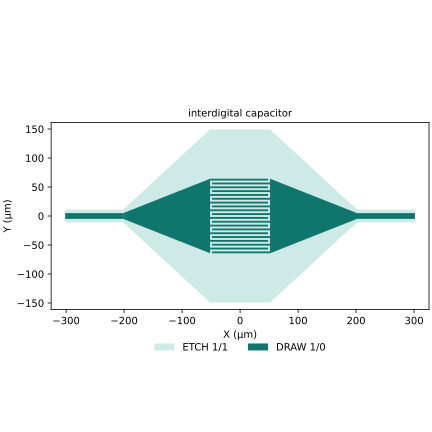
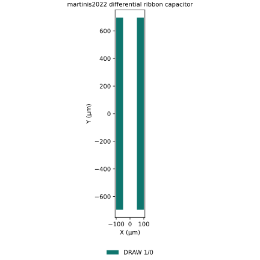
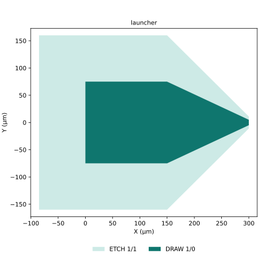

Choose a registered OrcaPen factory for the geometry you need. Activate the
PDK first, then inspect the factory's typed settings before changing dimensions.

For path-based cells, choose the widths, gaps, and layer recipe in
[Cross-sections](cross-sections.qmd), including CPW, coupled traces, and strips.

| Family | Examples |
| --- | --- |
| CPW and resonators | `straight`, `taper`, `resonator`, `resonator_hanger`, `resonator_meander` |
| Capacitors | `interdigital_capacitor`, `martinis2022_differential_ribbon_capacitor` |
| Connections | `launcher`, `cpw_t_junction`, `airbridge`, `indium_bump` |
| Primitives | `cpw_handoff`, `rounded_end_metal_segment`, `rounded_rectangle`, `wire_corner` |
| Simulation layouts | Square/circular pads, finite CPW, strips, flip-chip, airbridge, and TSV models in the [Model Gallery](test-components.md) |

Use the [generated cell API](../reference/index.qmd#cells) for signatures,
[shared primitives](shared-primitives.md) for their connection roles, and
[GDSFactory guides](component-authoring.md) for placement, connection, and routing.

## Choose a cell with flat tags

Factories use flat metadata tags for purpose (`layout` or `simulation`),
object (`capacitor`, `resonator`, `cpw`), and features such as `airbridge`
or `flip_chip`. Tags help you find source geometry; choose a separate
[simulation tutorial](../notebooks.qmd) for electrical behavior.

## Components Layout

Default layout previews show DRAW in deep teal and ETCH in light teal.
Use **+ / −**, drag, **Fit**, or **Expand** to inspect the existing images.

### Resonator

[Factory source: `resonator`](https://github.com/NCUPHY-LTLab/orcapen-sc-pdk/blob/aee7f8b848895f2d107f6b086310e866e8381f73/orcapen_sc_pdk/cells/layout/resonator.py)
builds a CPW resonator from hanger and meander sections.

{#fig-layout-resonator}



### Interdigital capacitor

[Factory source: `interdigital_capacitor`](https://github.com/NCUPHY-LTLab/orcapen-sc-pdk/blob/aee7f8b848895f2d107f6b086310e866e8381f73/orcapen_sc_pdk/cells/layout/capacitor.py)
provides the reusable interdigital capacitor layout.

`corner_radius_um=0.0` preserves the sharp default. Set a positive radius (for
example `corner_radius_um=1.0`) to round the merged electrode finger tips,
roots and taper transitions, and the ground-mask contour. Both outer CPW cut
planes stay flat, with unchanged ports and nominal straight finger/end gaps.
Real outer and hole boundaries are rounded separately; hole-serialization
bridges are not physical corners.
The existing `half` option is unchanged. Negative/nonfinite radii and tangent
arcs that cannot fit adjacent contour segments raise `ValueError`; the radius
is never silently reduced. Circular arcs are sampled at at most 5 degrees per
chord, including tangent endpoints, then quantized to the existing PDK grid.
Corner-local clearances can differ from nominal straight gaps. This geometry
option is not fabrication, DRC or solver certification; the preview below shows
the sharp default.

{#fig-layout-idc}



### Martinis ribbon capacitor

[Factory source: `martinis2022_differential_ribbon_capacitor`](https://github.com/NCUPHY-LTLab/orcapen-sc-pdk/blob/aee7f8b848895f2d107f6b086310e866e8381f73/orcapen_sc_pdk/cells/layout/martinis.py)
provides the differential ribbon capacitor layout.

{#fig-layout-martinis}



### Launcher

[Factory source: `launcher`](https://github.com/NCUPHY-LTLab/orcapen-sc-pdk/blob/aee7f8b848895f2d107f6b086310e866e8381f73/orcapen_sc_pdk/cells/layout/cpw.py)
provides the CPW launcher layout.

{#fig-layout-launcher}



### Bump geometry

[Factory source: `indium_ground`](https://github.com/NCUPHY-LTLab/orcapen-sc-pdk/blob/aee7f8b848895f2d107f6b086310e866e8381f73/orcapen_sc_pdk/cells/layout/indium.py)
provides indium bump `40/0` and UBM `40/1` footprints, without M1 DRAW/ETCH.
See the [Test Set's flip-chip view](test-components.md#reading-the-multi-level-views)
for layer-separated bump geometry.
