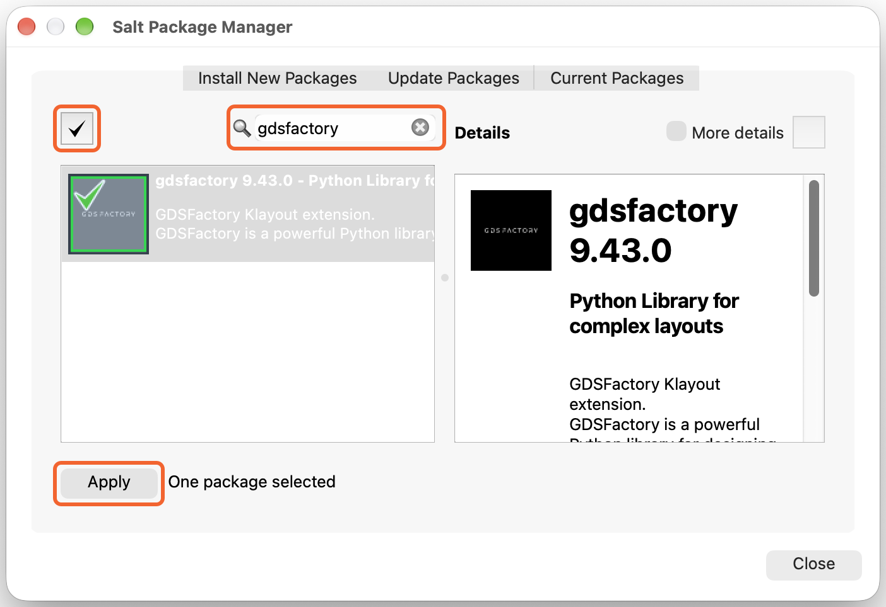
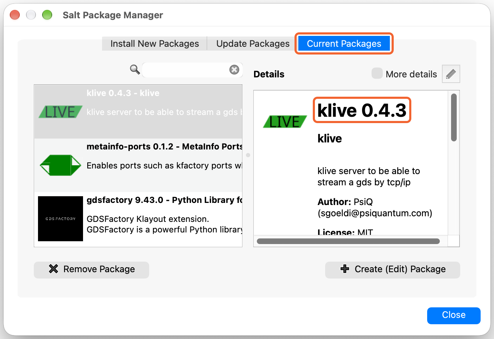
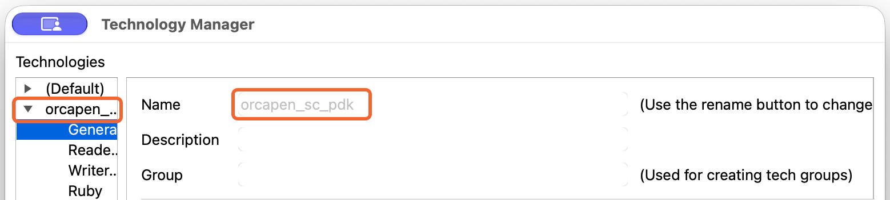
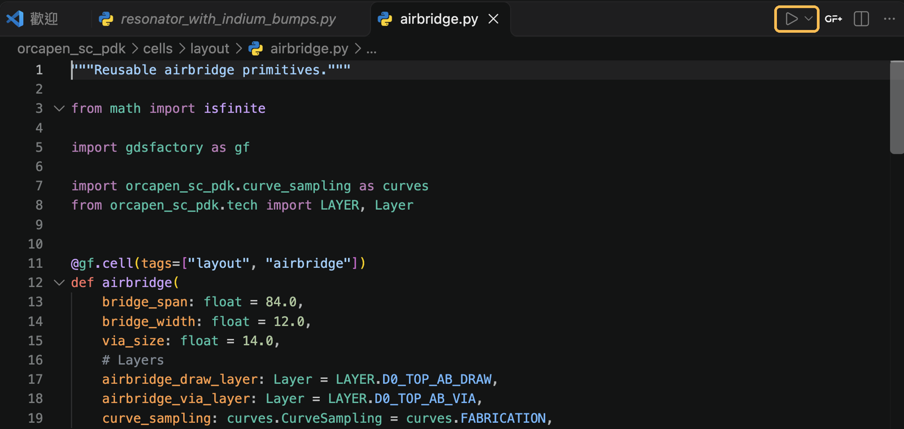
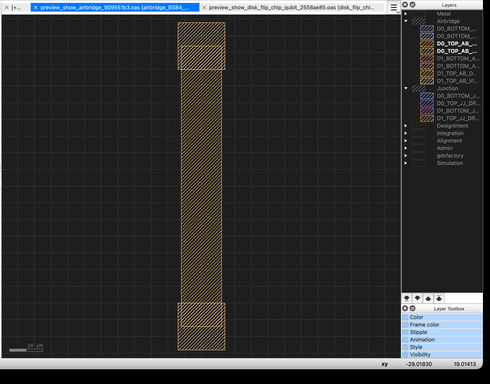

Choose a layout viewer based on whether you have a GDSFactory+ license.

- **With a license, use GDSFactory+.** Develop locally or keep the OrcaPen
  repository and Python environment on a remote host. VS Code Remote - SSH
  lets you preview layouts in VS Code on your own computer.
- **Without a license, use KLayout.** The supported KLayout workflow runs
  development and preview on the same computer. Keep the OrcaPen checkout,
  Python environment, and desktop KLayout there. KLive sends the preview
  to KLayout with OrcaPen's layer colors and groups.

## Use GDSFactory+

Open the OrcaPen repository in VS Code and use the extension's layout viewer.
Follow the official [local installation guide](https://gdsfactory.com/plus/local-install/)
or [Remote - SSH guide](https://gdsfactory.com/plus/troubleshooting/#using-gdsfactory-over-ssh).

## Use KLayout {#klayout}

### 1. Install desktop KLayout {#install-klayout}

Install the desktop app for your operating system using the
[KLayout download and installation guide](https://www.klayout.de/build.html).
Open KLayout once it is installed.

### 2. Install the GDSFactory package in KLayout {#install-klive}

Install the `gdsfactory` package from KLayout's package manager. KLayout
automatically installs its dependencies, including KLive, which receives
layouts from Python when you call `component.show()`.

1. In KLayout, open **Tools → Manage Packages → Install New Packages**.
2. Search for `gdsfactory` and select the result. Mark it with the checkmark
   button, then click **Apply**.

   

3. In **Ready for Installation**, confirm that `klive` is included on a fresh
   setup, then click **Ok**. Once installation completes, click **Close**.
   If KLayout asks to run the new packages' startup scripts, click **Yes**.
4. In **Current Packages**, check that `klive` is **0.4.0 or later**. OrcaPen
   needs that version to select the technology automatically. If you have an
   older version, use **Update Packages** to update `klive`.

   

The installation dialog can display the minimum requested dependency version.
**Current Packages** shows the installed version. The **LIVE** indicator
beside the Technology button should turn green. Click it to restart KLive
if it is red. See the [KLive guide](https://gdsfactory.github.io/klive/) for
the toolbar indicators.

### 3. Link the OrcaPen repository to KLayout {#link-orcapen-technology}

Use a local OrcaPen checkout that supports grouped previews, or download and
extract the [OrcaPen source for this guide](https://github.com/NCUPHY-LTLab/orcapen-sc-pdk/archive/1de5fe77a1d6a5d9b0f4cb36e9579e47f4004296.zip).
In a local terminal, open that folder and run:

```bash
uv sync -p 3.12
uv run python -m orcapen_sc_pdk.install_tech
```

The first command creates the project's `.venv` and installs its Python
dependencies, including GDSFactory. The second links the repository's
`orcapen_sc_pdk/klayout/` folder into KLayout as the `orcapen_sc_pdk` technology.
That folder contains the technology definition (`tech.lyt`) and grouped layer
properties (`layers.lyp`).

Restart KLayout. Open **Tools → Manage Technologies**, expand
`orcapen_sc_pdk`, and select **General**. Confirm the technology name, then close
the dialog. When a layout is open, the technology also appears in the
Technology dropdown on the toolbar.



Confirm that **LIVE** is green and leave KLayout open for the preview. If you
move the repository, rerun the second command from its new location to update
the link.

::: {.callout-tip title="Set a dark KLayout canvas"}
This guide uses a near-black canvas to match the OrcaPen layer palette.
Open **klayout → Preferences…** on macOS or **File → Setup** on other platforms.
Go to **Display → Background**, set **Background color** to `#1E1E1E`
(RGB 30, 30, 30), and click **Apply**.
:::

### 4. Run a cell file from VS Code {#run-python-file}

Open the local OrcaPen folder in VS Code and install the
[Microsoft Python extension](https://marketplace.visualstudio.com/items?itemName=ms-python.python).
From the Command Palette, run **Python: Select Interpreter** and select the
project's `.venv`.

For these steps, use a VS Code environment without the GDSFactory+ extension
installed. OrcaPen selects GDSFactory+ automatically when it detects the extension. Use the terminal command below to select KLayout explicitly.

1. Open `orcapen_sc_pdk/cells/layout/airbridge.py`.
2. Click **Run Python File** (▶) at the top right of the editor.

   

3. Switch to KLayout. KLive opens or refreshes the airbridge layout and selects
   the `orcapen_sc_pdk` technology. Expand **Airbridge** in the Layers panel to
   see the draw and via layers. If the layout does not open automatically,
   select the OrcaPen technology in KLayout and open `build/gds/airbridge.gds`.

   

When a file defines multiple cells, the button previews the cell selected in
its `__main__` block. To preview another registered cell, pass its name in a
local terminal:

```bash
uv run python -m orcapen_sc_pdk.preview resonator --viewer klayout
```

To send layouts from your own script with `component.show()`, see the
[GDSFactory KLayout integration guide](https://gdsfactory.github.io/gdsfactory/notebooks/_2_klayout/).
For an existing GDS file, see [View layers in KLayout](layers.qmd#view-layers-in-klayout)
to load the OrcaPen layer properties file (`.lyp`).

Continue to [Layers & Stack](layers.qmd) for layer names, GDS numbers, and
physical heights.
