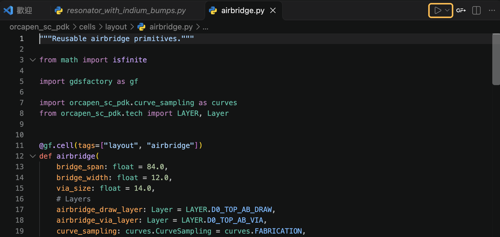
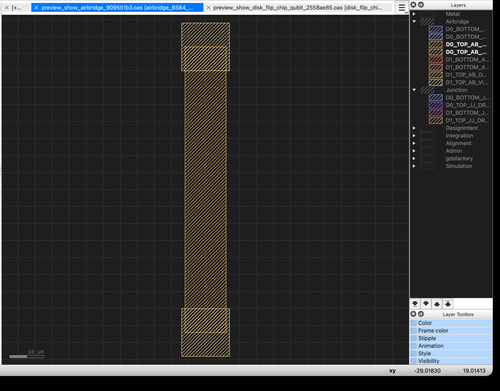

透過[公開儲存庫](https://github.com/NCUPHY-LTLab/orcapen-sc-pdk)貢獻可重複利用的元件、製程紀錄、範例或文件。請從變更所影響的 PDK 部分著手。

## 建立開發工作目錄

```bash
git clone https://github.com/NCUPHY-LTLab/orcapen-sc-pdk.git
cd orcapen-sc-pdk
uv sync -p 3.12
```

這會安裝 PDK 與開發工具 pytest、Ruff。接著設定你使用的檢視工具。GDSFactory+ 是選用工具，且需要付費訂閱。

**不使用 GDSFactory+**：安裝 [KLayout](https://www.klayout.de/)。在 KLayout 選擇 **Tools → Manage Packages**，搜尋並安裝 **klive**。保持 KLayout 開啟，執行 `component.show()` 即可直接顯示或更新版圖。安裝細節請見 [GDSFactory 的 KLayout 整合指南](https://gdsfactory.github.io/gdsfactory/notebooks/_2_klayout/)。若要套用 OrcaPen 圖層名稱和顏色，請參閱[在 KLayout 檢視圖層](start/layers.qmd)。

**使用 GDSFactory+**：用裝有 GDSFactory+ 擴充套件（2.3 版或更新）的 VS Code 開啟工作目錄，在 **GF+ Settings → Status** 選擇 **Setup Automatically**。擴充套件會把它的 SDK 與 worker 所需套件（包括 SPICE 用的 InSpice 與 vacask）安裝到 `.venv`。GDSFactory+ 需要 Python 3.12。

- 這些套件不在 `uv.lock` 裡，之後執行 `uv sync` 會把它們移除。再選一次 **Setup Automatically** 即可重新安裝。
- 擴充套件也會在 `pyproject.toml` 加入標示「Managed by GDSFactory+」的 `[tool.uv]` 區塊，並更新 `uv.lock`。請把這些修改留在本機、不要 commit：它們會讓所有人的 lock 檔只支援 Linux x86-64。

確認：`uv run python --version` 會回報支援的 Python 版本。文件相依套件與預覽方式請見[文件與網站](docs-publishing.md)。

## 預覽元件

### 從 VS Code 執行 cell 檔案並在 KLayout 檢視

先在 KLayout 安裝 **klive**，再於 OrcaPen 專案資料夾執行一次下列指令，安裝 OrcaPen 的 KLayout 製程設定。

```bash
uv run python -m orcapen_sc_pdk.install_tech
```

安裝後重新啟動 KLayout，並保持開啟。在 VS Code 開啟 OrcaPen 的專案資料夾，並安裝 [Microsoft Python 擴充套件](https://marketplace.visualstudio.com/items?itemName=ms-python.python)。在命令選擇區執行 **Python: Select Interpreter**，選擇由 `uv sync` 建立的專案 `.venv`。

> **預覽前先設定 KLayout 畫布。** OrcaPen 教學統一使用接近黑色的畫布（`#1E1E1E`），與圖層配色採用的深色背景一致。macOS 請開啟 **klayout → Preferences…**，其他平台請開啟 **File → Setup**。前往 **Display → Background**，將 **Background color** 設為 `#1E1E1E`（RGB 30、30、30），再按 **Apply**。這個選項控制版圖畫布。圖層顏色與分組由 OrcaPen 製程設定提供。

1. 開啟 `orcapen_sc_pdk/cells/layout/airbridge.py`。
2. 點擊編輯器右上角的 **執行 Python 檔案**（Run Python File，▶）。Python 擴充套件會執行該檔案及其中的 `if __name__ == "__main__":` 預覽區塊。

   

3. 切換到 KLayout。KLive 會開啟或更新 airbridge 版圖，並套用 `orcapen_sc_pdk` 製程設定。在 Layers 面板展開 **Airbridge**，即可看到繪製層與通孔層。若即時連線無法使用，可在 KLayout 選擇 OrcaPen 製程設定後，手動開啟 `build/gds/airbridge.gds`。

   

如果一個檔案定義了多個 cell，直接執行時會預覽 `__main__` 區塊選定的 cell。也可以在終端機直接執行檔案：

```bash
uv run python orcapen_sc_pdk/cells/layout/airbridge.py
```

也可以用名稱預覽任何已註冊的 cell：

```bash
uv run python -m orcapen_sc_pdk.preview resonator
```

兩者都會寫出 `build/gds/<cell>.gds` 並開啟。在已安裝 GDSFactory+ 的 VS Code 終端機中，檔案會在 GDSFactory+ Layout Viewer 開啟；否則會透過 klive 傳到 KLayout。可用 `--viewer klayout` 或 `--viewer gdsfactoryplus` 明確指定。新的 cell 模組也請以相同區塊結尾：

```python
if __name__ == "__main__":
    # Imported here because orcapen_sc_pdk.pdk imports this module.
    from orcapen_sc_pdk.preview import show

    show(my_cell)
```

## 讓變更聚焦

- 在 OrcaPen 放置可重複利用的佈局與製程定義。
- 使用 GDSFactory 組合元件與佈線。
- cell 一律直接以 `@gf.cell` 裝飾，GDSFactory+ 只辨識這種寫法。含曲線的 cell 接收 `curve_sampling: CurveSampling = FABRICATION`，並傳給巢狀元件與曲線 helper；詳見[曲線取樣](../usage/curve-sampling.md)。
- 使用 SCGSim 準備模擬、整合求解器並分析回傳結果。
- 將私人佈局、參數與執行目錄保留在使用端專案。

新增介面前，先檢查相關既有原始碼與範例。將相關文件放在描述其公開行為的位置。

## 提交變更

在提取要求中說明變更的行為、受影響的公開介面及已執行的檢查。已儲存的科學結果應與原始模型及執行環境對應；修改教學不會重新執行結果。

套件角色請見[工作區與相關套件](home/ecosystem-workspace.md)；來源與執行期的界線請見[SCGSim 整合](features/scgsim-integration.md)；筆記本配對與部署請見[文件與網站](docs-publishing.md)。
