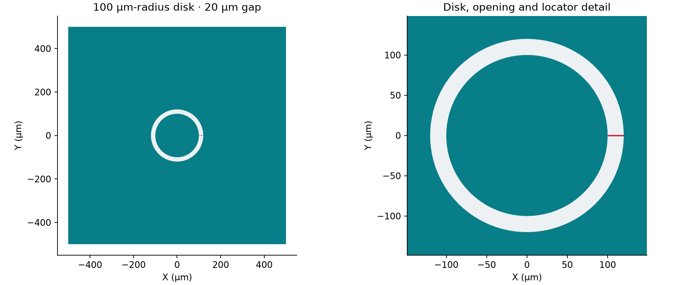

This synthetic `circular_pad_capacitor` linear LC model uses radius 100 µm,
radial gap 20 µm, a 1000 µm die, current PDK 100 nm Al and 500 µm Si.
The east-facing nonmetal locator binds the linear 10 nH inductive branch,
with no added capacitive branch. It is not ordinary CPW, generic RLC or a
measured device. Component source owns curved boundary chains and local
PAD/GROUND facts; this notebook owns final Nets.
This example uses SCGSim [`v3.0.0rc6`](https://github.com/NCUPHY-LTLab/scgsim/tree/v3.0.0rc6)
(`4c3edca`), the revision this repository pins, and stock Palace 0.18.1.

The default `run` action builds, prepares and solves this case, then reads its returned
results. Choose `AUTHORING_ONLY` for non-solving inputs or `prepare_handoff`
for a portable run package. Documentation rendering executes no code.
LiteratureCentral MA/MS/SA films are model assumptions, not measured loss.

::: {.callout-warning title="Historical run only; not evidence for this source"}
The original `circular_pad_palace_eigenmode_20261007_08`
cohort used SCGSim 1.1.0rc1 and reported 5.573354161115 GHz with retained
PCG warnings. Those results do not execute or validate this source; see the
[original evidence and identity manifest](https://github.com/OrPenStrike/orcapen-sc-pdk/blob/develop/notebooks/ComponentSimulation/CircularPad/evidence/README.md).
:::


```{python}
#| id: cpe-imports
import importlib.metadata
import json
import os
import subprocess
from pathlib import Path
from uuid import uuid4

from IPython.display import display
from scgsim.palace import reanalyze_epr, resolve_epr_result, show_epr

WORKFLOW_ACTION = "run"
# AUTHORING_ONLY | prepare_handoff | run | analyze_handoff | save_from_returned | analyze_saved_epr
if WORKFLOW_ACTION in {"AUTHORING_ONLY", "prepare_handoff", "run"}:
    import gdsfactory as gf
    from scgsim.geometry import GeometryPlan, LumpedElement
    from scgsim.meshing import HXT, MesherOptions
    from scgsim.palace import EigenmodeSim

    import orcapen_sc_pdk
    from orcapen_sc_pdk import (
        get_interface_preset_records,
        get_material_records,
        validate_interface_preset_records,
    )
    from orcapen_sc_pdk.tech import get_single_die_layer_stack

if WORKFLOW_ACTION in {"run", "analyze_handoff", "save_from_returned"}:
    from scgsim.palace import inspect_run_trustworthiness, resolve_palace_result

RUN_ID = f"circular_pad_palace_eigenmode_v2_{uuid4().hex}"
OUTPUT_ROOT = Path.cwd() / ".artifacts" / "SCGSimExamples" / "CircularPad"
RUN_ROOT = OUTPUT_ROOT / RUN_ID
if WORKFLOW_ACTION not in {
    "AUTHORING_ONLY",
    "prepare_handoff",
    "run",
    "analyze_handoff",
    "save_from_returned",
    "analyze_saved_epr",
}:
    raise ValueError("Unknown WORKFLOW_ACTION")
display({"scgsim_version": importlib.metadata.version("scgsim"), "run_id": RUN_ID})
```

## Build Component Coupon

```{python}
#| id: cpe-component
if WORKFLOW_ACTION in {"AUTHORING_ONLY", "prepare_handoff", "run"}:
    OUTER_RADIUS_UM = 100.0
    INNER_RADIUS_UM = 0.0
    GAP_UM = 20.0
    DIE_SIDE_UM = 1000.0
    JUNCTION_WIDTH_UM = 2.0
    orcapen_sc_pdk.activate()
    gf.clear_cache()
    component = gf.get_component(
        "circular_pad_capacitor",
        outer_radius_um=OUTER_RADIUS_UM,
        inner_radius_um=INNER_RADIUS_UM,
        gap_um=GAP_UM,
        die_side_um=DIE_SIDE_UM,
        junction_width_um=JUNCTION_WIDTH_UM,
    )
    layer_stack = get_single_die_layer_stack()
    plan = GeometryPlan(
        component=component,
        root_id="chip",
        layer_stack=layer_stack,
        material_records=get_material_records(),
        coupon_padding_um=0.0,
    )
    plan.set_nets({"pad": ("chip/PAD",), "ground": ("chip/GROUND",)})
    plan.set_vacuum_region(padding=(250.0, 250.0, 1000.0))
    display(component)
    display({"bbox_um": str(component.dbbox()), "ports": component.ports})
```

## Configure EPR / Problem

LiteratureCentral MA/MS/SA are synthetic model conventions, not measured
process data. The specs ask for the whole surfaces only. Setting
`inset_margins_um` in a spec would add bands a given distance from the gap
edge, which SCGSim cuts into the geometry; this workflow introduces no such study.

```{python}
#| id: cpe-problem
if WORKFLOW_ACTION in {"AUTHORING_ONLY", "prepare_handoff", "run"}:
    ROUTE = "B"
    records = validate_interface_preset_records(get_interface_preset_records())
    preset_names = {kind: f"LiteratureCentral_{kind}" for kind in ("MA", "MS", "SA")}
    interface_presets = {kind: records[name] for kind, name in preset_names.items()}
    # Surface EPR changes the geometry, so the plan holds it; prepare() after it.
    plan.set_surface_epr(
        {
            kind: {
                "thickness": record["thickness"],
                "permittivity": record["permittivity"],
                "loss_tangent": record["loss_tangent"],
                "source": record["source"],
                "preset": preset_names[kind],
            }
            for kind, record in interface_presets.items()
        }
    )
    # The junction sheet's inductor is a fact of the device, so the plan holds it too.
    PORT_NAME = "chip/o_junction_lumped"
    PORT_INDUCTANCE_H = 10e-9
    PORT_CAPACITANCE_F = 0.0  # Inductive-only model; the element is given no capacitance.
    plan.set_lumped_elements([LumpedElement(PORT_NAME, inductance_h=PORT_INDUCTANCE_H)])
    snapshot = plan.prepare()
    sim = EigenmodeSim()
    sim.set_route(ROUTE)
    sim.set_plan(snapshot)
    sim.set_output_dir(RUN_ROOT)
    sim.set_epr_request(
        surface_interfaces=("MA", "MS", "SA"), bulk_domain_ids=None, port_names=(PORT_NAME,)
    )
    NUM_MODES = 1
    SEARCH_FREQUENCY_HZ = 1e9  # Search lower bound, not a desired frequency.
    EIGENMODE_TOLERANCE = 1e-6
    SAVE_FIELDS = 1
    sim.set_eigenmode(
        num_modes=NUM_MODES,
        target=SEARCH_FREQUENCY_HZ,
        tolerance=EIGENMODE_TOLERANCE,
        save=SAVE_FIELDS,
    )
    display(
        {
            "route": ROUTE,
            "inductance_h": PORT_INDUCTANCE_H,
            "capacitance_f": PORT_CAPACITANCE_F,
            "interface_presets": interface_presets,
            "paired_gds_sha256": snapshot.gds_sha256,
        }
    )
    display(sim.input_summary())
```

## Build Mesh

Geometric order is independent of field FEM order. SCGSim owns the shared
curve arrangement, source rebinding, elevation and one HighOrder optimization.

```{python}
#| id: cpe-mesh
if WORKFLOW_ACTION in {"prepare_handoff", "run"}:
    # SCGSim's default sizing (FeatureRecipe). The former 10/200 um sizes map to
    # UniformBoundaryRecipe(10, 200), which leaves no clean mesh on this die (#66).
    # Meshing runs on one thread; the former MESH_THREADS has no replacement.
    ALGORITHM_3D = HXT
    GEOMETRY_ORDER = 2  # Geometry mesh degree, not field FEM order.
    HIGH_ORDER_OPTIMIZE = True
    sim.set_mesh(
        mesher=MesherOptions(
            algorithm_3d=ALGORITHM_3D,
            geometry_order=GEOMETRY_ORDER,
            high_order_optimize=HIGH_ORDER_OPTIMIZE,
        ),
    )
    MESH_PATH = sim.mesh()
    display(MESH_PATH)
    display(sim.mesh_summary())
```

## Generate Config

The maximum permits native early stopping; four completed AMR passes are not
required. Controls are declared inputs, not scientific acceptance criteria.

```{python}
#| id: cpe-config
if WORKFLOW_ACTION in {"prepare_handoff", "run"}:
    FEM_ORDER = 2
    LINEAR_TOLERANCE = 1e-6
    MAX_ITERATIONS = 2000
    AMR_MAX_PASSES = 4
    AMR_TOLERANCE = 0.02
    AMR_UPDATE_FRACTION = 0.15
    AMR_NONCONFORMAL = False
    SAVE_ADAPT_ITERATIONS = True
    sim.set_numerical(
        order=FEM_ORDER,
        tolerance=LINEAR_TOLERANCE,
        max_iterations=MAX_ITERATIONS,
        solver_type="Default",
        preconditioner="Default",
        device="CPU",
        amr_max_passes=AMR_MAX_PASSES,
        amr_tolerance=AMR_TOLERANCE,
        amr_update_fraction=AMR_UPDATE_FRACTION,
        amr_nonconformal=AMR_NONCONFORMAL,
        save_adapt_iterations=SAVE_ADAPT_ITERATIONS,
        output_paraview=True,
        output_grid_function=False,
    )
    CONFIG_PATH = sim.write_config()
    display(CONFIG_PATH)
    display(sim.mesh_summary())
```

## Prepare Handoff

Only `run` invokes the generated script. Use a fresh RUN_ID for each new
preparation; existing destinations fail rather than being overwritten. Exact
host executable/setup provenance belongs in the owner's execution receipt,
not a machine-local public default. There is no automatic retry or fallback.

::: {.callout-warning title="The generated script requires a Palace MPI wrapper"}
`PALACE_EXECUTABLE` must select an actual Palace MPI wrapper: the generated
script supplies `-np 8 -nt 1` through `resources["command_style"] = "wrapper"`.
A direct ELF is not a wrapper.
:::

Select a fresh RUN_ID before changing the action to `prepare_handoff` or `run`;
the fresh RUN_ID never names historical evidence.

```{python}
#| id: cpe-handoff
if WORKFLOW_ACTION in {"prepare_handoff", "run"}:
    MACHINE_PROFILE = "direct-local"
    PALACE_EXECUTABLE = os.environ["PALACE_EXECUTABLE"]
    SETUP_COMMANDS = tuple(os.environ.get("PALACE_SETUP_COMMANDS", "").splitlines())
    RESOURCES = {"processes": 8, "threads": 1, "command_style": "wrapper"}
    HANDOFF = sim.prepare_handoff(
        profile=MACHINE_PROFILE,
        executable=PALACE_EXECUTABLE,
        resources=RESOURCES,
        setup_commands=SETUP_COMMANDS,
    )
    display(HANDOFF)
    display({"retain_independently": HANDOFF.handoff_id})
    if WORKFLOW_ACTION == "run":
        subprocess.run([str(HANDOFF.script_path)], cwd=HANDOFF.run_dir, check=True)
```

## Analyze Returned Run

In a fresh analysis kernel, set `CIRCULAR_PAD_RETURNED_RUN_DIR` to the actual
returned folder and supply its independently retained preparation ID through
`CIRCULAR_PAD_PALACE_HANDOFF_ID`. There is no historical-path or identity default.
Missing inputs fail natively; failed/partial
results stay failed/partial and never become a strict completed result.
Analyze does not build, mesh or solve.

### Run Identity
### Numerical Evidence
### Simulation Benchmark

```{python}
#| id: cpe-trust
if WORKFLOW_ACTION in {"run", "analyze_handoff", "save_from_returned"}:
    RETURNED_RUN_DIR = (
        HANDOFF.run_dir
        if WORKFLOW_ACTION == "run"
        else Path(os.environ["CIRCULAR_PAD_RETURNED_RUN_DIR"])
    )
    EXPECTED_HANDOFF_ID = (
        HANDOFF.handoff_id
        if WORKFLOW_ACTION == "run"
        else os.environ["CIRCULAR_PAD_PALACE_HANDOFF_ID"]
    )
    report = inspect_run_trustworthiness(RETURNED_RUN_DIR)
    display(report.show_run_trustworthiness(show_details=True))
    display(report.show_simulation_benchmark(show_details=True))
    if WORKFLOW_ACTION == "save_from_returned" or report.completeness == "complete":
        result = resolve_palace_result(RETURNED_RUN_DIR, expected_handoff_id=EXPECTED_HANDOFF_ID)
```

### Physics Analysis Results

The physics view opens with each mode's frequency and Q, then the Surface-EPR
participation, one figure per interface kind. The junction participation
Palace reports is signed (`signed_palace=true`): it is neither absolute-valued
nor interpreted as a negative physical energy. Surface values cover the whole
surfaces, with no insets; the interface losses are synthetic model inputs.

```{python}
#| id: cpe-physics
if WORKFLOW_ACTION in {"run", "analyze_handoff", "save_from_returned"}:
    if report.completeness == "complete":
        display(result.show_physics_quantities(ranking_limit=None))
        epr = result.epr_result()
        display(show_epr(epr, mode=1))
    else:
        display(report.show_physics_quantities(ranking_limit=None))
```

### Saved EPR and Offline Loss

Strict completed result extraction and loss reanalysis require no new component,
GDS, CAD, mesh or fields. Empty overrides preserve the verified assumptions;
explicit caller film edits change offline loss assumptions, not native fields.
Use real Group IDs in the portable snapshot. Do not absolute-value signed EPR.
The caller-owned save destination is opened exclusively to avoid overwrite.

```{python}
#| id: cpe-save-epr
if WORKFLOW_ACTION == "save_from_returned":
    EPR_SAVE_PATH = Path(os.environ["CIRCULAR_PAD_PALACE_EPR_SAVE_PATH"])
    epr = result.epr_result()
    with EPR_SAVE_PATH.open("x", encoding="utf-8") as stream:
        json.dump(epr.to_payload(), stream, indent=2)
```

Set `WORKFLOW_ACTION = "analyze_saved_epr"` in a fresh kernel to reuse a
specified snapshot. This action reads only the saved EPR path; it requires no
returned run directory, handoff ID, component, GeometryPlan, mesh or fields.
`save_from_returned` creates a new path exclusively from an actual strict
returned result. Existing files are never silently reused as a save fallback.
`analyze_handoff` does not create a snapshot.

```{python}
#| id: cpe-offline-epr
if WORKFLOW_ACTION in {"save_from_returned", "analyze_saved_epr"}:
    EPR_SAVE_PATH = Path(os.environ["CIRCULAR_PAD_PALACE_EPR_SAVE_PATH"])
    saved_epr = resolve_epr_result(EPR_SAVE_PATH)
    SURFACE_DEFAULTS = {}  # Explicit MA/MS/SA film assumptions, if requested.
    GROUP_OVERRIDES = {}  # Real saved Group IDs only.
    offline_epr = reanalyze_epr(
        saved_epr,
        surface_defaults=SURFACE_DEFAULTS,
        group_overrides=GROUP_OVERRIDES,
    )
    display(show_epr(offline_epr, mode=1))
```

### Simulation Performance / Benchmarks

Read the benchmark's mesh, unknowns, time and resources per AMR pass beside
the declared controls. Second-order geometry gives curved element faces; it
does not by itself establish continuous-circle fidelity or geometric accuracy.
No Q/T1, cross-solver equivalence, accuracy or convergence conclusion follows.
