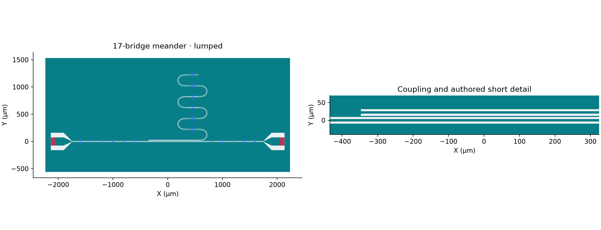

Excite the launcher variant through its two neutral nonmetal sheets. Read the
[Driven Terminal requirement](../../../../simulation/requirements/driven-terminal.qmd)
for the system and expected output. The same source supports can receive
[Eigenmode RLC treatments](aedt_hfss_eigenmode_rlc.ipynb) without redrawing them.

Fresh construction uses the local shared-physical candidate, not a
published wheel. Retained results keep their original runtime identities.

Published historical baseline: [SCGSim](https://github.com/OrPenStrike/scgsim/tree/c9270c7e76e0b2df187dddde462079e00d410dd0).

## Action and identity

```{python}
#| id: meander-terminal-lumped-imports
import json
import subprocess
import sys
from importlib.metadata import version
from pathlib import Path
from uuid import uuid4

from IPython.display import display
from scgsim.aedt import (
    AedtResources,
    FrequencySweepSpec,
    HfssRunControl,
    LumpedTerminalPort,
    prepare_hfss_driven_from_geometry,
    prepare_planar_geometry_input,
    resolve_results,
)
from scgsim.geometry import (
    ApproximationProfile,
    GeometryBuildInput,
    LayoutPolygonSpec,
    LumpedSupport,
    SemanticEntitySpec,
    VacuumRegionSpec,
    apply_vacuum_region_to_stack,
)

import orcapen_sc_pdk
from orcapen_sc_pdk.cells import cpw_meander_airbridge_lumped_coupon
from orcapen_sc_pdk.cells.simulation import get_cpw_meander_airbridge_source_records

WORKFLOW_ACTION = "run"  # author | prepare_handoff | prepare_only | run | analyze
VARIANT = "lumped"
RUN_ID = f"meander-terminal-lumped-{uuid4().hex[:12]}"
OUTPUT_ROOT = Path("notebooks/.artifacts/SCGSimExamples/ComponentSimulation/CpwMeanderAirbridge")
RUN_DIR = OUTPUT_ROOT / RUN_ID
RETURNED_RUN_DIR = OUTPUT_ROOT / "returned-run"
ANALYSIS_KIND = "strict"  # strict | receipt_only
display({name: version(name) for name in ("scgsim", "gdsfactory", "orcapen-sc-pdk")})
```

## Layout, stack and neutral sheets


```{python}
#| id: meander-terminal-lumped-layout
if WORKFLOW_ACTION != "analyze":
    orcapen_sc_pdk.activate()
    coupon = cpw_meander_airbridge_lumped_coupon()
    coupon.plot()
```

M1 Al is 100 nm; posts start at its upper face, with deck underside 3 µm above
that face and deck thickness 0.3 µm. Each launcher support is the actual 202/1
nonmetal sheet at Z=0.05 µm, normal +Z, local dimensions 85×150 µm. Its ordered
contacts run Signal→positive Ground. It is not a conductor or a junction.



## Terminal ownership and sweep controls

P1 is left and P2 is right. Each exact Signal Entity and positive Ground Entity
comes from its source declaration. One Ground Entity can own multiple positive
rings; native names/order are not guessed. Impedance is explicitly 50 Ω, with
no renormalization or deembedding. These are **Driven Terminal Lumped ports**,
not Driven Modal ports.

```{python}
#| id: meander-terminal-lumped-settings
MODEL = "thin_film"
APPROXIMATION_PROFILE = ApproximationProfile(name=MODEL, revision="v1", parameters={})
impedance_ohm = 50.0
resources = AedtResources(cores=4, ram_limit_percent=20)
geometry_workers = 1
run_control = HfssRunControl(
    setup_name="Setup1",
    sweep_name="Sweep1",
    sweep=FrequencySweepSpec(3.0, 8.0, 3),
    maximum_passes=2,
    minimum_passes=1,
    minimum_converged_passes=1,
    maximum_delta_s=0.02,
    percent_refinement=30.0,
)
if WORKFLOW_ACTION != "analyze":
    ports = tuple(
        LumpedTerminalPort(
            index=i,
            name=f"P{i}",
            support_id=s.support_id,
            signal_entity_ids=s.terminal_a_entity_ids,
            reference_entity_ids=s.terminal_b_entity_ids,
            impedance_ohm=impedance_ohm,
            renormalize=False,
            deembed_um=0.0,
        )
        for i, s in enumerate(supports, 1)
    )
    display([p.to_payload() for p in ports])
    display(run_control.to_payload())
```

The selected source enclosure retains its finite XY and source air top. HFSS
uses the closed default exterior. Numerical controls inherit the selected
short-observation case; neither two passes nor three sweep samples promises
convergence or resolution of the resonator response.

## Prepare / handoff

```{python}
#| id: meander-terminal-lumped-prepare
HANDOFF = None
if WORKFLOW_ACTION in {"prepare_handoff", "prepare_only", "run"}:
    geometry = prepare_planar_geometry_input(
        build_input,
        prepared_stack=stack,
        modeling=APPROXIMATION_PROFILE.name,
    )
    HANDOFF = prepare_hfss_driven_from_geometry(
        modeling=APPROXIMATION_PROFILE.name,
        geometry=geometry,
        project_name=RUN_ID,
        design_name="MeanderTerminalLumped",
        run_control=run_control,
        ports=ports,
        output_dir=RUN_DIR,
        geometry_workers=geometry_workers,
        resources=resources,
    )
    display(HANDOFF)
```

Source and effective sheet Z remain distinct. Review the explicit physical
contact association and enabled port settings in the handoff. Preparation and
native execution are not performed in this documentation round.

## Run: explicit native transaction

```{python}
#| id: meander-terminal-lumped-run
if WORKFLOW_ACTION == "run":
    subprocess.run([str(HANDOFF.script_path)], cwd=HANDOFF.run_dir, check=True)
```

## Prepare-only native model inspection

Select `prepare_only` to build, read back, save and release the native model
without Analyze. This does not produce solved physics results.

```{python}
#| id: aedt-hfss-driven-terminal-lumped-prepare-only
if WORKFLOW_ACTION == "prepare_only":
    from scgsim.aedt import resolve_prepared_model

    subprocess.run(
        [
            sys.executable,
            "-m",
            "scgsim.aedt.run",
            "--handoff",
            str(HANDOFF.metadata_path),
            "--execute",
            "--prepare-only",
        ],
        check=True,
    )
    display(resolve_prepared_model(HANDOFF.run_dir))
```

## Returned Run: fresh kernel / relocated input

```{python}
#| id: meander-terminal-lumped-returned
RESULT = None
if WORKFLOW_ACTION in {"run", "analyze"}:
    if WORKFLOW_ACTION == "run" or ANALYSIS_KIND == "strict":
        RESULT = resolve_results(HANDOFF.run_dir if WORKFLOW_ACTION == "run" else RETURNED_RUN_DIR)
    elif ANALYSIS_KIND == "receipt_only":
        display(json.loads((RETURNED_RUN_DIR / "metadata/aedt_run_receipt.json").read_text()))
    else:
        raise ValueError("choose strict or receipt_only analysis")
```

### S-data and resource history

```{python}
#| id: meander-terminal-lumped-report
if RESULT is not None:
    display(RESULT.physics_results())
    display(RESULT.simulation_benchmark())
    display(RESULT.show_all_results(show_details=True))
```

Inspect actual terminal order/references, S-data frequency and units, boundary
type, pass history and warnings. Keep missing native properties missing. Port
impedance settings do not prove line characteristic impedance. The
[Wave variant](aedt_hfss_driven_terminal_wave.ipynb) is a different exterior-cut
model, not an aligned-plane numerical-equivalence experiment.
