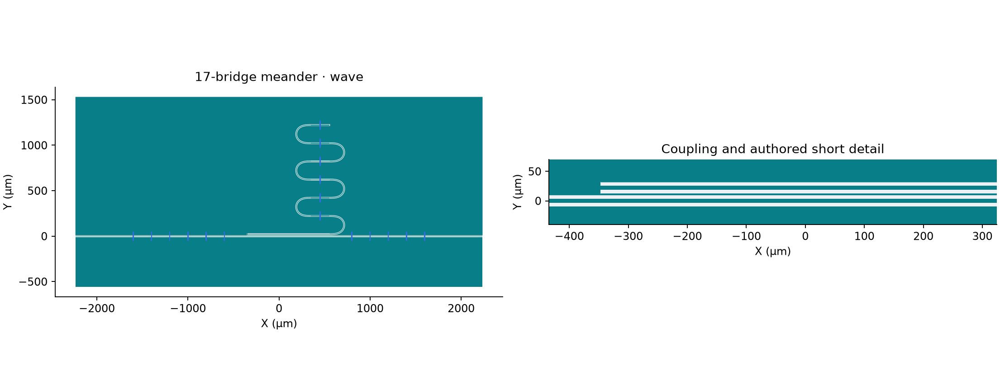

Use the same selected MTL/meander/17-bridge core **without launchers**. P1/P2
are exterior YZ cuts at the left/right ends. Read the
[Driven Terminal requirement](../../../../simulation/requirements/driven-terminal.qmd)
for the intended workflow; compare source port models with the
[Lumped variant](aedt_hfss_driven_terminal_lumped.ipynb), not numerical equality.

Fresh construction uses the local shared-physical candidate, not a
published wheel. Retained results keep their original runtime identities.

Published historical baseline: [SCGSim](https://github.com/OrPenStrike/scgsim/tree/c9270c7e76e0b2df187dddde462079e00d410dd0).

## Action and identity

```{python}
#| id: meander-terminal-wave-imports
import json
import subprocess
import sys
from importlib.metadata import version
from pathlib import Path
from uuid import uuid4

from IPython.display import display
from scgsim.aedt import (
    AedtResources,
    FrequencySweepSpec,
    HfssRunControl,
    TerminalPort,
    prepare_hfss_driven_from_geometry,
    prepare_planar_geometry_input,
    resolve_results,
)
from scgsim.geometry import (
    ApproximationProfile,
    GeometryBuildInput,
    LayoutPolygonSpec,
    LumpedSupport,
    SemanticEntitySpec,
    VacuumRegionSpec,
    apply_vacuum_region_to_stack,
)

import orcapen_sc_pdk
from orcapen_sc_pdk.cells import cpw_meander_airbridge_wave_coupon
from orcapen_sc_pdk.cells.simulation import get_cpw_meander_airbridge_source_records

WORKFLOW_ACTION = "run"  # author | prepare_handoff | prepare_only | run | analyze
VARIANT = "wave"
RUN_ID = f"meander-terminal-wave-{uuid4().hex[:12]}"
OUTPUT_ROOT = Path("notebooks/.artifacts/SCGSimExamples/ComponentSimulation/CpwMeanderAirbridge")
RUN_DIR = OUTPUT_ROOT / RUN_ID
RETURNED_RUN_DIR = OUTPUT_ROOT / "returned-run"
ANALYSIS_KIND = "strict"  # strict | receipt_only
display({name: version(name) for name in ("scgsim", "gdsfactory", "orcapen-sc-pdk")})
```

## Layout and cut-plane source facts


```{python}
#| id: meander-terminal-wave-layout
if WORKFLOW_ACTION != "analyze":
    orcapen_sc_pdk.activate()
    coupon = cpw_meander_airbridge_wave_coupon()
    coupon.plot()
```

The physical PDK stack is unchanged: M1 Al 100 nm, posts 3 µm, deck 0.3 µm.
The no-launcher through ends reach the finite domain's exterior. The normal is
outward −X / +X; Signal/reference membership is a separate explicit source
declaration. No internal launcher sheet is substituted for either Wave port.



## Wave membership and sweep controls

```{python}
#| id: meander-terminal-wave-settings
MODEL = "thin_film"
APPROXIMATION_PROFILE = ApproximationProfile(name=MODEL, revision="v1", parameters={})
resources = AedtResources(cores=4, ram_limit_percent=20)
geometry_workers = 1
run_control = HfssRunControl(
    setup_name="Setup1",
    sweep_name="Sweep1",
    sweep=FrequencySweepSpec(3.0, 8.0, 3),
    maximum_passes=2,
    minimum_passes=1,
    minimum_converged_passes=1,
    maximum_delta_s=0.02,
    percent_refinement=30.0,
)
if WORKFLOW_ACTION != "analyze":
    ports = tuple(
        TerminalPort(
            index=i,
            name=f"P{i}",
            side={"left": "-X", "right": "+X"}[declaration["side"]],
            reference_objects=tuple(declaration["reference_entity_ids"]),
            signal_entity_ids=(declaration["signal_entity_id"],),
            deembed_um=0.0,
        )
        for i, declaration in enumerate(source["wave_sources"], 1)
    )
    display(source["wave_sources"])
    display([p.to_payload() for p in ports])
    display(run_control.to_payload())
```

The Wave cuts have zero X-region padding and share the explicitly ordered
positive Ground reference membership. The existing public Wave treatment owns
its port normalization; no unsupported normalization option is invented here.
The selected short sweep uses the original 3…8 GHz / 3-point control. Do not
interpret it as a resolved resonator lineshape or a convergence guarantee.

## Prepare / handoff

```{python}
#| id: meander-terminal-wave-prepare
HANDOFF = None
if WORKFLOW_ACTION in {"prepare_handoff", "prepare_only", "run"}:
    geometry = prepare_planar_geometry_input(
        build_input,
        prepared_stack=stack,
        modeling=APPROXIMATION_PROFILE.name,
    )
    HANDOFF = prepare_hfss_driven_from_geometry(
        modeling=APPROXIMATION_PROFILE.name,
        geometry=geometry,
        project_name=RUN_ID,
        design_name="MeanderTerminalWave",
        run_control=run_control,
        ports=ports,
        output_dir=RUN_DIR,
        geometry_workers=geometry_workers,
        resources=resources,
    )
    display(HANDOFF)
```

Preparation must retain actual finite Ground holes, all deck/post bodies,
source/effective Z and the declared enclosure. Its source input is not proof
of actual native Wave Port type, face membership or model contact.

## Run: explicit native transaction

```{python}
#| id: meander-terminal-wave-run
if WORKFLOW_ACTION == "run":
    subprocess.run([str(HANDOFF.script_path)], cwd=HANDOFF.run_dir, check=True)
```

## Prepare-only native model inspection

Select `prepare_only` to build, read back, save and release the native model
without Analyze. This does not produce solved physics results.

```{python}
#| id: aedt-hfss-driven-terminal-wave-prepare-only
if WORKFLOW_ACTION == "prepare_only":
    from scgsim.aedt import resolve_prepared_model

    subprocess.run(
        [
            sys.executable,
            "-m",
            "scgsim.aedt.run",
            "--handoff",
            str(HANDOFF.metadata_path),
            "--execute",
            "--prepare-only",
        ],
        check=True,
    )
    display(resolve_prepared_model(HANDOFF.run_dir))
```

## Returned Run: fresh kernel / relocated input

```{python}
#| id: meander-terminal-wave-returned
RESULT = None
if WORKFLOW_ACTION in {"run", "analyze"}:
    if WORKFLOW_ACTION == "run" or ANALYSIS_KIND == "strict":
        RESULT = resolve_results(HANDOFF.run_dir if WORKFLOW_ACTION == "run" else RETURNED_RUN_DIR)
    elif ANALYSIS_KIND == "receipt_only":
        display(json.loads((RETURNED_RUN_DIR / "metadata/aedt_run_receipt.json").read_text()))
    else:
        raise ValueError("choose strict or receipt_only analysis")
```

### Terminal S-data and native provenance

```{python}
#| id: meander-terminal-wave-report
if RESULT is not None:
    display(RESULT.physics_results())
    display(RESULT.simulation_benchmark())
    display(RESULT.show_all_results(show_details=True))
```

Inspect actual Wave boundary labels, terminal order/reference conductors,
frequency/units, deembedding zero, S-data and retained warnings. Keep native
readback, strict completion and Report presentation distinct. No extra field
solve, second Analyze, retry or reference-plane matching is introduced.
