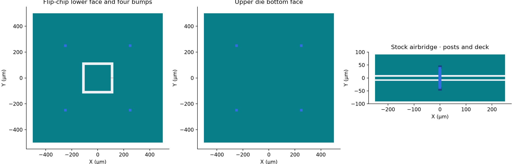

Inspect conductor contacts across film, post, deck and bump levels while
retaining each material and physical Z interval. Read the
[multilevel-contact requirements](../../../../simulation/tools/contacts-multilevel.qmd)
and [material/stack/Z requirements](../../../../simulation/tools/materials-stack-z.qmd).
OrcaPen supplies physical layers and coupon contact intent; callers assign Nets;
SCGSim owns preparation and all native geometry/assignment/mesh mechanics.

These cells use SCGSim [`v3.0.0rc5`][scgsim-rc5] (`20a5d2b`), the revision this
repository pins.
Native contacts remain unobserved. No notebook run or saved output is attached.

## Environment and observation identity

```{python}
#| id: gmc-environment
import importlib.metadata
from uuid import uuid4

import gdsfactory as gf
from IPython.display import display
from scgsim.geometry import (
    ApproximationProfile,
    GeometryPlan,
    interpret_physical_geometry,
    summarize_geometry_input,
)

import orcapen_sc_pdk
from orcapen_sc_pdk import get_material_records
from orcapen_sc_pdk.tech import get_single_die_layer_stack, get_two_die_flip_chip_layer_stack

OBSERVATION_ID = f"geometry-multilevel-{uuid4().hex}"
display(
    {
        "observation_id": OBSERVATION_ID,
        "scgsim_version": importlib.metadata.version("scgsim"),
        "scgsim_revision": "20a5d2b2bf48eb8600564c7f3df205b8be913a9d",
        "units": "XY, Z intervals and physical thickness: um",
        "evidence_stage": "source and physical-interpretation records",
    }
)
orcapen_sc_pdk.activate()
gf.clear_cache()
```

## Flip-chip pad: actual lower die and four bump children

Reuse `flip_chip_pad_coupon()` unchanged. Each bump has its existing positive
body and UBM footprint; only source-declared physical Entities are registered.
Upper Ground is root-owned and faces outward -Z. Lower pad's locator remains
nonmetal and unexcited. Source intent is Ground-to-Ground contact away from
the central Pad; shared Net membership alone does not prove native contact.

```{python}
#| id: gmc-flip-chip-source
flip = gf.get_component("flip_chip_pad_coupon")
flip_stack = get_two_die_flip_chip_layer_stack()
flip.plot()
display(flip.info["inspection_source_intent"])
flip_refs = {reference.name: reference for reference in flip.insts}
flip_plan = GeometryPlan(
    flip,
    root_id="chip",
    layer_stack=flip_stack,
    material_records=get_material_records(),
    coupon_padding_um=0.0,
)
for name in ("LOWER_PAD_DIE", "BUMP_MM", "BUMP_MP", "BUMP_PM", "BUMP_PP"):
    flip_plan.register_instance(f"chip/{name}", flip_refs[name])
flip_plan.set_nets(
    {
        "pad": ("chip/LOWER_PAD_DIE/PAD",),
        "ground": (
            "chip/LOWER_PAD_DIE/GROUND",
            "chip/UPPER_GROUND",
            "chip/BUMP_MM/D0_D1_INDIUM_BUMP",
            "chip/BUMP_MP/D0_D1_INDIUM_BUMP",
            "chip/BUMP_PM/D0_D1_INDIUM_BUMP",
            "chip/BUMP_PP/D0_D1_INDIUM_BUMP",
        ),
    }
)
flip_plan.set_vacuum_region(padding=(250.0, 250.0, 1000.0))
flip_snapshot = flip_plan.prepare()
display({"gds_sha256": flip_snapshot.gds_sha256, "occurrences": flip_snapshot.source_occurrences})
display(summarize_geometry_input(flip_snapshot.geometry_input, prepared_stack=flip_snapshot.stack))
```

## CPW airbridge: positive base, posts and deck

Reuse `cpw_airbridge_coupon()` and its actual `AIRBRIDGE` child unchanged.
The current nominal stack has base Al 0–0.1 um, 3 um posts at 0.1–3.1 um,
and a 0.3 um deck at 3.1–3.4 um. The source retains the existing partial
12 × 7 um deck/post overlap; it is not remodeled into an arch or extended deck.
Posts land on the two base Ground strips, while the deck crosses Signal with
clearance. No GF or native port is invented for this coupon.

```{python}
#| id: gmc-airbridge-source
bridge = gf.get_component("cpw_airbridge_coupon")
bridge_stack = get_single_die_layer_stack(include_airbridges=True)
bridge.plot()
display(bridge.info["inspection_source_intent"])
bridge_refs = {reference.name: reference for reference in bridge.insts}
bridge_plan = GeometryPlan(
    bridge,
    root_id="chip",
    layer_stack=bridge_stack,
    material_records=get_material_records(),
    coupon_padding_um=0.0,
)
bridge_plan.register_instance("chip/AIRBRIDGE", bridge_refs["AIRBRIDGE"])
bridge_plan.set_nets(
    {
        "signal": ("chip/SIGNAL",),
        "ground": (
            "chip/GROUND_MINUS",
            "chip/GROUND_PLUS",
            "chip/AIRBRIDGE/DECK",
            "chip/AIRBRIDGE/PIER_MINUS",
            "chip/AIRBRIDGE/PIER_PLUS",
        ),
    }
)
bridge_plan.set_vacuum_region(padding=(250.0, 250.0, 1000.0))
bridge_snapshot = bridge_plan.prepare()
display(
    {"gds_sha256": bridge_snapshot.gds_sha256, "occurrences": bridge_snapshot.source_occurrences}
)
display(
    summarize_geometry_input(bridge_snapshot.geometry_input, prepared_stack=bridge_snapshot.stack)
)
```

## Physical finite Z, source holes and declarations

Read physical intervals and modeling declarations from the selected PDK
stacks, not from a handwritten replacement stack. Source polygon records retain
outer rings and holes. UBM source footprint availability does not create an
additional physical body when the stack has not declared one.

```{python}
#| id: gmc-physical-records
for case_id, stack, snapshot in (
    ("06-flip-chip", flip_stack, flip_snapshot),
    ("07-airbridge", bridge_stack, bridge_snapshot),
):
    for level_id, level in stack.layers.items():
        display(
            {
                "case_id": case_id,
                "level_id": level_id,
                "z_min_um": level.zmin,
                "thickness_um": level.thickness,
                "z_max_um": level.zmin + level.thickness,
                "source_layer": str(level.layer),
                "material": level.material,
                "source_info": level.info,
            }
        )
    display(
        {
            "case_id": case_id,
            "source_entities": snapshot.geometry_input.entities,
            "polygons_with_holes": snapshot.geometry_input.polygons,
        }
    )
```

## Public Solid and Thin Film interpretation maps

Both choices consume the same immutable source snapshot. `solid` retains
physical bodies. `thin_film` removes source-declared stack-film height once,
keeps source-declared retained solids, and collapses the local deck film
on its declared contact side without removing the deck height from the global
stack. Source/effective intervals and physical-layer identities are produced
by SCGSim's `interpret_physical_geometry`, the step every Palace and AEDT
preparation takes, not by a notebook mapping function. It builds no CAD body
or mesh; no excitation or Surface-EPR study is selected here.

`D0_D1_INDIUM_BUMP` is declared `finite_volume`, preserving its finite
physical height in either representation. The editable selection below starts
with the airbridge maps; select `06-flip-chip` to inspect the flip-chip
records. Neither declaration nor interpretation establishes native contact or
mesh coverage.

```{python}
#| id: gmc-modeling-preparation
interpreted_cases = {}
MODELING_CASE = "07-airbridge"  # 06-flip-chip | 07-airbridge
MODELING_CHOICES = ("solid", "thin_film")
snapshot = {"06-flip-chip": flip_snapshot, "07-airbridge": bridge_snapshot}[MODELING_CASE]
for modeling in MODELING_CHOICES:
    approximation_profile = ApproximationProfile(name=modeling, revision="v1", parameters={})
    _, _, representation = interpret_physical_geometry(
        snapshot.geometry_input, snapshot.stack, approximation_profile
    )
    interpreted_cases[(MODELING_CASE, modeling)] = representation
    display(
        {
            "case_id": MODELING_CASE,
            "modeling": modeling,
            "representation_source_sha256": representation.source_sha256,
            "collapse_intervals_um": representation.collapse_intervals,
            "entities": {
                entity_id: {
                    "physical_layer_id": facts["physical_layer_id"],
                    "representation": facts["representation"],
                    "source_interval_um": facts["source_interval_um"],
                    "effective_interval_um": facts["effective_interval_um"],
                }
                for entity_id, facts in representation.entities.items()
            },
            "source_snapshot_gds_sha256": snapshot.gds_sha256,
        }
    )
```

## Native contact and mesh observations remain future work

`GeometryPlan.prepare()` and `interpret_physical_geometry()` produce source
and physical-interpretation records, not native bodies or meshes. No CAD/native
launch, Gmsh, mesh, terminal assignment, solve, or fields are requested here.
Inspect actual bump endpoint contacts, post/base and deck/post interfaces,
Signal clearance, retained holes, and native source/effective Z readback before
claiming those later stages. No tolerance or contact eligibility Gate is added.
Missing source declarations or unsupported public preparation fail visibly;
there is no notebook-local fallback, guessed contact reconstruction, or result.

[scgsim-rc5]: https://github.com/NCUPHY-LTLab/scgsim/tree/v3.0.0rc5
