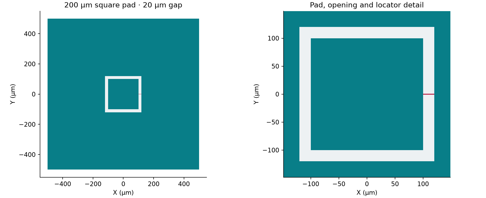

在已授權 AEDT 的同一台主機，從全新核心（Kernel）建立正方形焊墊（SimplePad）模型、準備交接包並立即執行 HFSS 本徵模態（Eigenmode）與表面能量參與率（Surface EPR）求解。所有設定都在這份筆記本中，不需要先執行其他筆記本。

若要先準備再搬移到另一台主機，使用 [Prepare Handoff](aedt_hfss_eigenmode_prepare.qmd) → [執行既有交接包（Run）](aedt_hfss_eigenmode_run.qmd)；兩條路線都可使用 [Analyze](aedt_hfss_eigenmode_analyze.qmd) 深入分析回傳結果。



## 環境與公開版本

本教學使用本儲存庫釘選的 [SCGSim `v3.0.0rc6`](https://github.com/NCUPHY-LTLab/scgsim/tree/v3.0.0rc6)（`4c3edca`）。在本儲存庫根目錄同步含 AEDT 選用相依的環境，並在 Jupyter 選擇這個環境的 Python 核心（Kernel）：

```bash
uv sync --locked --group aedt-notebooks
```

原生求解另需已授權的 AEDT。本例選用 AEDT 2024.2、PyAEDT 1.3.0；SCGSim 同時支援明確選用 AEDT 2023.2。

確認：以下儲存格列出已安裝套件版本。SCGSim 的版本號為 `3.0.0rc6`。

```{python}
#| id: hem-direct-imports
from importlib.metadata import version
from pathlib import Path
from uuid import uuid4

import gdsfactory as gf
from IPython.display import display
from scgsim.aedt import (
    AedtResources,
    EigenmodeRunControl,
    EigenmodeSim,
    EprAnalysisRequest,
)
from scgsim.geometry import GeometryPlan, LumpedElement

import orcapen_sc_pdk
from orcapen_sc_pdk import (
    get_interface_preset_records,
    get_material_records,
    validate_interface_preset_records,
)
from orcapen_sc_pdk.tech import get_single_die_layer_stack

display({name: version(name) for name in ("orcapen-sc-pdk", "scgsim", "pyaedt")})
```

## 版圖、堆疊與導體網路

保留 200 µm 焊墊、20 µm 間隙及 1000 µm 晶片。預設堆疊為 100 nm 鋁膜與 500 µm 矽基板；焊墊及接地（Ground）分別指定為兩個導體網路（Net）。

```{python}
#| id: hem-direct-geometry
PAD_SIDE_UM = 200.0
GAP_UM = 20.0
DIE_SIDE_UM = 1000.0
JUNCTION_WIDTH_UM = 2.0
VACUUM_PADDING_UM = (250.0, 250.0, 1000.0)

orcapen_sc_pdk.activate()
gf.clear_cache()
component = gf.get_component(
    "square_pad_capacitor",
    pad_side_um=PAD_SIDE_UM,
    gap_um=GAP_UM,
    die_side_um=DIE_SIDE_UM,
    junction_width_um=JUNCTION_WIDTH_UM,
)
plan = GeometryPlan(
    component=component,
    root_id="chip",
    layer_stack=get_single_die_layer_stack(),
    material_records=get_material_records(),
    coupon_padding_um=0.0,
)
plan.set_nets({"pad": ("chip/PAD",), "ground": ("chip/GROUND",)})
plan.set_vacuum_region(padding=VACUUM_PADDING_UM)
display(component)
display({"bbox_um": str(component.dbbox()), "ports": component.ports})
```

## 實體近似與線性接面

選用實體金屬（`solid`）；另一個公開近似為薄膜（`thin_film`）。本例維持東側接面由焊墊沿 +X 指向 Ground，電感為 10 nH、電容為 0；它是線性負載，不包含 Josephson 非線性。

接面是元件本身的事實，因此宣告在版圖計畫（GeometryPlan）上，以它所在的埠片（Port sheet）`chip/o_junction_lumped` 命名。計畫自行找出埠片兩端的焊墊與 Ground；只有電感、沒有電阻的元件在 HFSS 中成為接面，它在 EPR 請求中的識別名稱就是埠片名稱。

版圖的非金屬定位片（Locator）以一個 0.001 µm 資料庫單位接觸兩端，實體間隙維持 20 µm。外部區域維持 HFSS 原生處理，不額外指定 Region PerfectE、Radiation 或 PML。

```{python}
#| id: hem-direct-model
MODELING = "solid"
AEDT_VERSION = "2024.2"
PORT_NAME = "chip/o_junction_lumped"
PORT_INDUCTANCE_H = 10e-9
PORT_CAPACITANCE_F = 0.0  # Inductive-only model; the element is given no capacitance.

# The junction is a fact of the device, so the plan holds it; its EPR id is its sheet's name.
plan.set_lumped_elements([LumpedElement(PORT_NAME, inductance_h=PORT_INDUCTANCE_H)])
sim = EigenmodeSim(modeling=MODELING, aedt_version=AEDT_VERSION)
```

## 模態搜尋與自適應設定

搜尋下限為 1 GHz，要求一個模態，最多 10 個自適應網格回合（Adaptive pass），頻率變化目標為 1%。保留既有最少回合、連續收斂回合及網格細化比例；實際是否收斂由回傳紀錄判讀。

```{python}
#| id: hem-direct-numerics
run_control = EigenmodeRunControl(
    setup_name="Setup1",
    minimum_frequency_ghz=1.0,
    num_modes=1,
    maximum_passes=10,
    maximum_delta_frequency_percent=1.0,
    minimum_passes=1,
    minimum_converged_passes=1,
    percent_refinement=30.0,
)
```

## 表面介面、薄膜與退縮距離

選用金屬－空氣（MA）、金屬－基板（MS）及基板－空氣（SA）的 `LiteratureCentral` 介面預設。薄膜厚度、相對介電常數與損耗角正切來自 PDK 記錄；不設退縮距離（Margin），只取整個表面；這些是文獻假設，不是量測損耗。

本例沿用水平表面選擇，以 `face_kinds` 排除側壁（Sidewall）。表面能量參與率會改變幾何，因此和接面一樣屬於版圖計畫：宣告後才呼叫 `plan.prepare()`，HFSS 從快照讀取兩者。

```{python}
#| id: hem-direct-surfaces
PRESET_NAMES = {kind: f"LiteratureCentral_{kind}" for kind in ("MA", "MS", "SA")}
HORIZONTAL_FACE_KINDS = ("sheet", "top", "bottom", "interface")  # Every face kind but sidewalls.
presets = validate_interface_preset_records(get_interface_preset_records())
surface_specs = {
    kind: {
        "film_thickness_m": presets[preset_name]["thickness"] * 1e-6,  # The preset is in um.
        "permittivity": presets[preset_name]["permittivity"],
        "loss_tangent": presets[preset_name]["loss_tangent"],
        "source": presets[preset_name]["source"],
        "preset": preset_name,
        "face_kinds": HORIZONTAL_FACE_KINDS,
    }
    for kind, preset_name in PRESET_NAMES.items()
}
# Surface EPR changes the geometry, so the plan holds it; prepare() after it.
plan.set_surface_epr(surface_specs)
snapshot = plan.prepare()
sim.set_plan(snapshot)
sim.set_epr_request(
    EprAnalysisRequest(
        mode_indices=(1,),
        surface_epr_groups=None,
        junction_ids=(PORT_NAME,),
        bulk_domain_ids=None,
    )
)
display(sim.surface_epr_specs)
display(sim.input_summary().data["backend"]["lumped_elements"])
```

`surface_epr_groups=None` 選取宣告的全部表面群組；`bulk_domain_ids=None` 納入全部原生體域，包括 Region。

## 執行身分、資源與新輸出位置

在準備交接包前選定求解資源。本例保留 4 核心、30% 記憶體的請求值；實際執行前，請由執行主機分配可用資源。

```{python}
#| id: hem-direct-identity
RUN_ID = f"simple_pad_aedt_hfss_eigenmode_{uuid4().hex}"
OUTPUT_ROOT = Path.cwd() / ".artifacts" / "SCGSimExamples" / "SimplePad"
RUN_DIR = OUTPUT_ROOT / RUN_ID
RESOURCES = AedtResources(cores=4, ram_limit_percent=30)

sim.set_output_dir(RUN_DIR)
sim.set_eigenmode(
    project_name=RUN_ID,
    design_name="SimplePadEigenmode",
    run_control=run_control,
    resources=RESOURCES,
)
display(sim.input_summary())
```

## 準備這次執行的交接包

SCGSim 要求全新的輸出資料夾。這一步將目前設定寫入交接包；下一格直接執行同一份包，不重建幾何或重新準備。封存檔位置以實際顯示的 `archive_path` 為準。

```{python}
#| id: hem-direct-handoff
handoff = sim.prepare_handoff()
display({
    "run_dir": handoff.run_dir,
    "script_path": handoff.script_path,
    "spec_path": handoff.spec_path,
    "metadata_path": handoff.metadata_path,
    "receipt_path": handoff.receipt_path,
    "manifest_path": handoff.manifest_path,
    "archive_path": handoff.archive_path,
})
```

確認：交接包包含這次的規格、來源幾何、執行腳本與中繼資料。先確認 AEDT 授權與主機資源，再執行下一格。

## 在本機直接執行

下列儲存格會啟動 AEDT，依包內設定完成原生建模、求解、匯出、儲存與釋放。執行器（Runner）讀取剛準備好的包，不重新準備；新的求解請從全新核心開始，產生另一個 `RUN_ID` 與輸出資料夾。

```{python}
#| id: hem-direct-execute
import subprocess
import sys

subprocess.run(
    [
        sys.executable,
        "-m",
        "scgsim.aedt.run",
        "--handoff",
        str(handoff.metadata_path),
        "--execute",
    ],
    check=True,
)
```

確認：檢查這次回傳的執行紀錄與收斂狀態。若執行失敗，保留原始紀錄及錯誤，不自動重跑。

## 讀取執行結果

### 物理分析結果（Physics）

以下讀取同一個新輸出資料夾；若沒有完整結果，保留 SCGSim 的錯誤，不自動求解。模態、原生回合與 EPR 圖的完整判讀見 [Analyze](aedt_hfss_eigenmode_analyze.qmd)。

```{python}
#| id: hem-direct-results
result = sim.resolve_results(handoff.run_dir)
display({"returned_run_dir": handoff.run_dir})
result.show_all_results(show_details=True)
display(result.physics_results())
```

### 計算成本（Performance）

```{python}
#| id: hem-direct-performance
display(result.simulation_benchmark())
```
