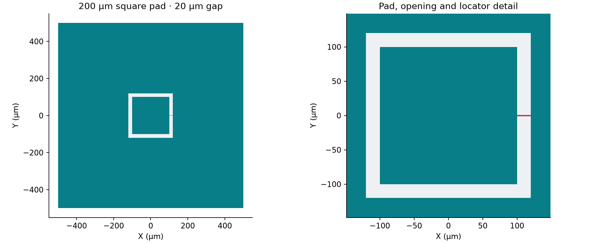

Build the default public SimplePad and inspect its layout first. Then use that
component for capacitance extraction, with settings placed beside the operation
they control.

<a href="aedt_q3d.ipynb" data-noresolveinput download>Download IPYNB</a> ·
<a href="../../../src/SCGSimExamples/ComponentSimulation/SimplePad/aedt_q3d.qmd" data-noresolveinput download>Download QMD source</a>



## Part 1 — Construct and inspect the layout

### Load layout APIs and choose an action

These imports use the layout/PDK APIs, not SCGSim or AEDT.
The default action is `prepare_handoff`; choosing `analyze_handoff` skips
component construction so a returned run can be read independently.

```{python}
#| id: q3d-layout-imports
import gdsfactory as gf
from IPython.display import display

import orcapen_sc_pdk
from orcapen_sc_pdk import get_material_records
from orcapen_sc_pdk.tech import get_single_die_layer_stack

WORKFLOW_ACTION = "prepare_handoff"
if WORKFLOW_ACTION not in {
    "AUTHORING_ONLY",
    "prepare_handoff",
    "prepare_only",
    "run",
    "analyze_handoff",
}:
    raise ValueError("Unknown WORKFLOW_ACTION")
```

### Build the registered default component

The factory provides the 200 µm pad, 20 µm opening clearance, 1000 µm die, and 2 µm
junction locator width. No geometry settings are overridden here. The single-die
stack supplies Al 0.1 µm above Si 500 µm; its nonmetal locator is not a Q3D body.

```{python}
#| id: q3d-component
if WORKFLOW_ACTION != "analyze_handoff":
    orcapen_sc_pdk.activate()
    gf.clear_cache()
    component = gf.get_component("square_pad_capacitor")
```

```{python}
#| id: q3d-layout-inspection
if WORKFLOW_ACTION != "analyze_handoff":
    display(component)
    component.plot()
    display({"bbox_um": str(component.dbbox())})
```

```{python}
#| id: q3d-settings-inspection
if WORKFLOW_ACTION != "analyze_handoff":
    display({
        "component_name": component.name,
        "settings": component.settings,
    })
```

```{python}
#| id: q3d-ports-inspection
if WORKFLOW_ACTION != "analyze_handoff":
    display([
        {
            "name": port.name,
            "center_um": port.dcenter,
            "width_um": port.dwidth,
            "orientation_deg": port.orientation,
            "port_type": port.port_type,
            "layer": port.layer,
        }
        for port in component.ports
    ])
```

```{python}
#| id: q3d-stack-inspection
if WORKFLOW_ACTION != "analyze_handoff":
    layer_stack = get_single_die_layer_stack()
    display([
        {
            "level": name,
            "z_min_um": level.zmin,
            "z_max_um": level.zmin + level.thickness,
            "thickness_um": level.thickness,
            "material": level.material,
        }
        for name, level in layer_stack.layers.items()
    ])
```

Check the layout, actual factory settings, physical port records, and stack
together. Keep `component` and `layer_stack` available for Part 2.

## Part 2 — Configure, prepare, run, and read the simulation

### Load the simulation APIs and identify the runtime

::: {.callout-warning title="Runtime requirement"}
The terminal-pair API used below is in the public SCGSim source at commit [`99242d2d35a20e04ea2c4fb6a0092bd7b61e544d`](https://github.com/NCUPHY-LTLab/scgsim/tree/99242d2d35a20e04ea2c4fb6a0092bd7b61e544d); the existing `2.0.0rc15` wheel does not include it. The requested solver versions remain AEDT 2024.2 and PyAEDT 1.3.0.
:::

```{python}
#| id: q3d-imports
import importlib.metadata
import os
import subprocess
import sys
from pathlib import Path
from uuid import uuid4

from scgsim.aedt import (
    AedtResources,
    MatrixRunControl,
    PdkMaterial,
    Q3dTerminalPair,
    prepare_q3d_from_geometry,
    resolve_results,
)
from scgsim.geometry import GeometryPlan
```

```{python}
#| id: q3d-runtime
AEDT_VERSION = "2024.2"
PYAEDT_VERSION = "1.3.0"
SCGSIM_SOURCE_STATUS = "PUBLIC_TOPIC_SOURCE_CHECKPOINT"
SCGSIM_SOURCE_COMMIT = "99242d2d35a20e04ea2c4fb6a0092bd7b61e544d"
SCGSIM_SOURCE_TREE = "17603c7a9cbc8c47be2edc8f14ac762428515a62"
SCGSIM_SOURCE_BASE_COMMIT = "1db787b5f5296099b4623a2cce76677c7d1aaeab"
SCGSIM_SOURCE_PATCH_SHA256 = "cbe39b25670fd4d717e008e1d4b1f6bdffd0f64a8ae7f42264825129e856df34"
display(
    {
        "requested_aedt": AEDT_VERSION,
        "producer_locked_pyaedt": PYAEDT_VERSION,
        "installed_pyaedt": importlib.metadata.version("pyaedt"),
        "installed_scgsim": importlib.metadata.version("scgsim"),
        "required_scgsim_source_status": SCGSIM_SOURCE_STATUS,
        "required_scgsim_source_commit": SCGSIM_SOURCE_COMMIT,
        "required_scgsim_source_tree": SCGSIM_SOURCE_TREE,
        "required_scgsim_base_commit": SCGSIM_SOURCE_BASE_COMMIT,
        "required_scgsim_patch_sha256": SCGSIM_SOURCE_PATCH_SHA256,
    }
)
```

### Select material identities and electrical Net intent

Material identities come from the selected PDK records. `GeometryPlan` uses the
component roles `PAD` and `GROUND` under root `chip`, producing `chip/PAD` and
`chip/GROUND`. The final Nets map Signal `pad` and Ground `ground` to those
entities. The `pad` terminal pair keeps source and sink on `chip/PAD`, at −Z
and +Z respectively. These assignments are distinct from the nonmetal junction
locator.

```{python}
#| id: q3d-materials
if WORKFLOW_ACTION != "analyze_handoff":
    material_records = get_material_records()
    materials = {
        material_id: PdkMaterial(
            material_id,
            material_records[material_id]["material_kind"],
            material_records[material_id]["is_superconducting"],
            material_records[material_id]["aedt_library_name"],
        )
        for material_id in ("Al", "Si", "vacuum")
    }
```

```{python}
#| id: q3d-nets
if WORKFLOW_ACTION != "analyze_handoff":
    final_nets = {
        "pad": ("chip/PAD",),
        "ground": ("chip/GROUND",),
    }
    net_types = {"pad": "Signal", "ground": "Ground"}
    physical_ground_nets = ("ground",)
    terminal_pairs = {
        "pad": Q3dTerminalPair(
            source_entity_id="chip/PAD",
            source_side="-Z",
            sink_entity_id="chip/PAD",
            sink_side="+Z",
        ),
    }
```

### Build the simulation geometry

`GeometryPlan` combines the registered Part 1 `component` and `layer_stack` with
the PDK material records; it does not override the factory geometry. The Signal
pad and connected Ground occupy the Al layer; the substrate occupies the selected
Si interval. The nonmetal junction locator is excluded from Q3D bodies.

```{python}
#| id: q3d-controls
RUN_ID = f"simple_pad_aedt_q3d_{uuid4().hex}"
OUTPUT_ROOT = Path.cwd() / ".artifacts" / "SCGSimExamples" / "SimplePad"
RUN_DIR = OUTPUT_ROOT / RUN_ID
```

```{python}
#| id: q3d-source
if WORKFLOW_ACTION != "analyze_handoff":
    plan = GeometryPlan(
        component=component,
        root_id="chip",
        layer_stack=layer_stack,
        material_records=material_records,
        coupon_padding_um=0.0,
    )
    plan.set_nets(final_nets)
```

```{python}
#| id: q3d-geometry
if WORKFLOW_ACTION != "analyze_handoff":
    display(plan.entities)
```

### Configure the extraction

This remains a 5 GHz capacitance/conductance extraction with ten adaptive passes
and a 1% convergence request. The minimum-pass and refinement defaults are
unchanged. It is a PEC extraction model, not a finite-conductivity loss
measurement.

```{python}
#| id: q3d-setup
SETUP_NAME = "Setup1"
EXTRACTION_FREQUENCY_GHZ = 5.0
MAXIMUM_PASSES = 10
CONVERGENCE_PERCENT = 1.0
if WORKFLOW_ACTION != "analyze_handoff":
    run_control = MatrixRunControl(
        setup_name=SETUP_NAME,
        frequency_ghz=EXTRACTION_FREQUENCY_GHZ,
        maximum_passes=MAXIMUM_PASSES,
        convergence_percent=CONVERGENCE_PERCENT,
    )
```

### Keep the solid model and exterior with the request

Use solid Al and Si, the original open Region padding, no AC/RL solve, and no
dedicated grounded enclosure Net. After setting the padding on `plan`,
`plan.prepare()` captures a geometry snapshot that retains the final Net
membership set by `plan.set_nets()`. `prepare_q3d_from_geometry` receives
that snapshot with the materials, Net types, terminal pairs, and matrix controls.

```{python}
#| id: q3d-model-controls
MODELING = "solid"
VACUUM_PADDING_UM = (250.0, 250.0, 1000.0)
```

```{python}
#| id: q3d-spec
if WORKFLOW_ACTION in {"prepare_handoff", "prepare_only", "run"}:
    plan.set_vacuum_region(padding=VACUUM_PADDING_UM)
    snapshot = plan.prepare()
    display(snapshot.geometry_input)
```

### Choose resources, prepare, and explicitly run

The original resource request is four cores and 30% RAM. Preparation writes
a fresh portable handoff without opening AEDT; only the explicit `run` action
invokes the generated native runner. Retain the handoff/spec identity when
moving the package to another host.

```{python}
#| id: q3d-resources
RESOURCES = AedtResources(cores=4, ram_limit_percent=30)
```

```{python}
#| id: q3d-handoff
if WORKFLOW_ACTION in {"prepare_handoff", "prepare_only", "run"}:
    px, py, pz = VACUUM_PADDING_UM
    HANDOFF = prepare_q3d_from_geometry(
        snapshot,
        aedt_version=AEDT_VERSION,
        modeling=MODELING,
        output_dir=RUN_DIR,
        project_name=RUN_ID,
        design_name="SimplePadQ3d",
        materials=materials,
        net_types=net_types,
        physical_ground_nets=physical_ground_nets,
        terminal_pairs=terminal_pairs,
        run_control=run_control,
        region_padding_um=(px, px, py, py, pz, pz),
        resources=RESOURCES,
    )
    display(HANDOFF)
    if WORKFLOW_ACTION == "run":
        subprocess.run([str(HANDOFF.script_path)], cwd=HANDOFF.run_dir, check=True)
```

### Optional: inspect a native model without solving

Select `prepare_only` to construct, read back, save and release the native model
without Analyze. This action produces model observations, not solved
capacitance.

```{python}
#| id: aedt-q3d-prepare-only
if WORKFLOW_ACTION == "prepare_only":
    from scgsim.aedt import resolve_prepared_model

    subprocess.run(
        [
            sys.executable,
            "-m",
            "scgsim.aedt.run",
            "--handoff",
            str(HANDOFF.metadata_path),
            "--execute",
            "--prepare-only",
        ],
        check=True,
    )
    display(resolve_prepared_model(HANDOFF.run_dir))
```

### Read a returned run

In a fresh kernel, choose `analyze_handoff` and set
`SIMPLE_PAD_RETURNED_RUN_DIR` to the actual returned directory.
Strict resolution reads retained inputs, receipt and native observations.

```{python}
#| id: q3d-resolve
if WORKFLOW_ACTION in {"run", "analyze_handoff"}:
    RETURNED_RUN_DIR = (
        HANDOFF.run_dir
        if WORKFLOW_ACTION == "run"
        else Path(os.environ["SIMPLE_PAD_RETURNED_RUN_DIR"])
    )
    result = resolve_results(RETURNED_RUN_DIR)
    # Trust/identity and native numerical/performance evidence precede physics.
    result.show_all_results(show_details=True)
```

### Physics

Read each capacitance and conductance matrix with units, conductor order,
reference convention and any matrix reduction.

```{python}
#| id: q3d-physics
if WORKFLOW_ACTION in {"run", "analyze_handoff"}:
    display(result.physics_results())
```

### Performance

Inspect the requested setup and actual adaptive/resource history alongside
the extracted quantities.

```{python}
#| id: q3d-benchmark
if WORKFLOW_ACTION in {"run", "analyze_handoff"}:
    display(result.simulation_benchmark())
```

### Saved project and release

The generated runner saves the project and releases its owned Desktop session.
The returned project and receipt paths identify those retained artifacts.

```{python}
#| id: q3d-release
if WORKFLOW_ACTION in {"run", "analyze_handoff"}:
    display({"project": result.project_path, "receipt": result.receipt_path})
elif WORKFLOW_ACTION in {"prepare_handoff", "prepare_only", "run"}:
    display(HANDOFF.archive_path)
```

For generic backend APIs, use the
[SCGSim documentation](https://github.com/OrPenStrike/scgsim/tree/develop/docs)
at the version selected for the completed tutorial.
