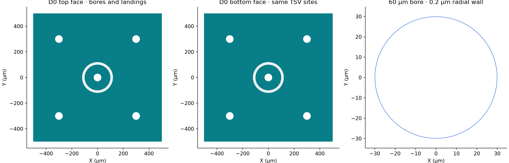

Build a Concentric Signal joined through a hollow TSV, with separate top and
bottom Ground planes connected by four Ground TSVs. The default full-run flow
extracts C/G at 5 GHz with at most three adaptive passes and 1% convergence.
AC R/L is off. These are Human-confirmed first-trial controls, not accuracy
or scientific-success criteria. Native execution and shared-runtime admission
remain pending; this source authoring is not a solved result.
See the [TSV model-inspection guide](../../../../simulation/tsv-model-inspection.qmd)
and [capacitance requirement](../../../../simulation/requirements/electrostatic-capacitance.qmd).

Fresh construction uses the local shared-physical candidate, not a
published wheel. Retained results keep their original runtime identities.

Published historical baseline: [SCGSim](https://github.com/OrPenStrike/scgsim/tree/c9270c7e76e0b2df187dddde462079e00d410dd0).


## Setup and Imports

The following cells use public OrcaPen source and SCGSim models. No Desktop opens
during imports or source authoring.

## Setup and Run Controls

`run` prepares a fresh handoff, invokes the full-solve CLI, then reads actual
results. `prepare_handoff` stops at the portable inputs; `source` constructs
layout/source records only. `analyze_handoff` reads an explicit returned root
without constructing a coupon, calling the getter, writing GDS, preparing or
launching the CLI. Separately, `build_model` uses `run_control=None` and the
candidate's native model-only Prepare Only model transaction; `inspect_model` reads that
returned model. Neither model-only action represents Model+Setup or reuse.

```{python}
#| id: tsv-q3d-controls
import hashlib
import json
import subprocess
import sys
from dataclasses import replace
from importlib.metadata import version
from pathlib import Path
from uuid import uuid4

from IPython.display import display
from scgsim.aedt import (
    MatrixRunControl,
    PdkMaterial,
    prepare_q3d_from_geometry,
    resolve_prepared_model,
    resolve_results,
)
from scgsim.geometry import (
    ApproximationProfile,
    GeometryBuildInput,
    GeometryPlanSnapshot,
    LayoutPolygonSpec,
    SemanticEntitySpec,
)

import orcapen_sc_pdk
from orcapen_sc_pdk.cells import get_tsv_source_records, tsv_concentric_signal_coupon

# Actions: run | prepare_handoff | analyze_handoff | source | build_model | inspect_model
WORKFLOW_ACTION = "run"
DIE = "D0"
DIE_SIDE_UM = 1000.0
BORE_DIAMETER_UM = 60.0
WALL_THICKNESS_UM = 0.2
SIGNAL_OUTER_RADIUS_UM = 100.0
GAP_UM = 20.0
GROUND_TSV_OFFSET_UM = 300.0
MODEL = "thin_film"  # face films become sheets; TSV levels remain retained_solid.
APPROXIMATION_PROFILE = ApproximationProfile(name=MODEL, revision="v1", parameters={})
SETUP_NAME = "Setup1"
EXTRACTION_FREQUENCY_GHZ = 5.0
MAXIMUM_PASSES = 3
CONVERGENCE_PERCENT = 1.0
MINIMUM_PASSES = 1
MINIMUM_CONVERGED_PASSES = 1
PERCENT_REFINEMENT = 30.0
RUN_CONTROL = (
    None
    if WORKFLOW_ACTION == "build_model"
    else MatrixRunControl(
        setup_name=SETUP_NAME,
        frequency_ghz=EXTRACTION_FREQUENCY_GHZ,
        maximum_passes=MAXIMUM_PASSES,
        convergence_percent=CONVERGENCE_PERCENT,
        minimum_passes=MINIMUM_PASSES,
        minimum_converged_passes=MINIMUM_CONVERGED_PASSES,
        percent_refinement=PERCENT_REFINEMENT,
    )
)
RUN_ID = f"tsv-concentric-q3d-{uuid4().hex[:12]}"
OUTPUT_ROOT = Path(".artifacts/SCGSimExamples/TSV")
RUN_DIR = OUTPUT_ROOT / RUN_ID
SOURCE_DIR = OUTPUT_ROOT / f"{RUN_ID}-source"
RETURNED_RUN_DIR = None  # Set an explicit actual root for analyze_handoff or inspect_model.
PROJECT_NAME = "TSVConcentricQ3DThinFilm"
DESIGN_NAME = "Q3D"
REGION_PADDING_XYZ_UM = (250.0, 250.0, 1000.0)
RESOURCES = None  # No host allocation selected here; native admission is separate.
SIGNAL_ENTITY_IDS = (f"{DIE}/TOP_SIGNAL", f"{DIE}/BOTTOM_SIGNAL", f"{DIE}/SIGNAL_WALL")
GROUND_ENTITY_IDS = (f"{DIE}/TOP_GROUND", f"{DIE}/BACK_GROUND") + tuple(
    f"{DIE}/GROUND_TSV_{i}" for i in range(4)
)
if WORKFLOW_ACTION not in {
    "run",
    "prepare_handoff",
    "analyze_handoff",
    "source",
    "build_model",
    "inspect_model",
}:
    raise ValueError("Unknown WORKFLOW_ACTION")
display({name: version(name) for name in ("orcapen-sc-pdk", "gdsfactory", "scgsim")})
```

Solver resource flags are not an aggregate OS cap or CAD containment mechanism.
Execute a native action only under the available host allocation. Q3D has no
HFSS port or radiation boundary in this case. Source/Sink terminals are not
added to this terminal-free C/G model.

## Create Simulation Component / Coupon

```{python}
#| id: tsv-q3d-coupon
if WORKFLOW_ACTION not in {"analyze_handoff", "inspect_model"}:
    orcapen_sc_pdk.activate()
    coupon = tsv_concentric_signal_coupon(
        die=DIE,
        die_side_um=DIE_SIDE_UM,
        bore_diameter_um=BORE_DIAMETER_UM,
        wall_thickness_um=WALL_THICKNESS_UM,
        signal_outer_radius_um=SIGNAL_OUTER_RADIUS_UM,
        gap_um=GAP_UM,
        ground_tsv_offset_um=GROUND_TSV_OFFSET_UM,
    )
    coupon.plot()
```

M1 Al thickness and the 500 µm Silicon substrate come from the PDK. The 0.2 µm
TiN wall is a finite solid; its interior remains empty. These are nominal
OrcaPen research dimensions, not a reproduction of a cited fabrication process.

## Initialize AEDT Project / App

The selected design is Q3D. The native CLI owns initialization later during
`run` or `build_model`; no manual Desktop attachment or second client is used here.



## Simulation Configuration

```{python}
#| id: tsv-q3d-handoff
HANDOFF = None
if WORKFLOW_ACTION in {"run", "prepare_handoff", "build_model"}:
    # Public detached record, not a claim that GeometryPlan.prepare registered these children.
    snapshot = GeometryPlanSnapshot(
        build_input, json.dumps(stack), gds_bytes, gds_sha256, tuple(source["source_occurrences"])
    )
    used_materials = {e.material_id for e in build_input.entities}
    materials = {
        name: PdkMaterial(
            material_id=name,
            kind=stack["materials"][name]["material_kind"],
            is_superconducting=stack["materials"][name]["is_superconducting"],
            library_name=stack["materials"][name]["aedt_library_name"],
        )
        for name in used_materials
    }
    HANDOFF = prepare_q3d_from_geometry(
        snapshot,
        modeling=APPROXIMATION_PROFILE.name,
        output_dir=RUN_DIR,
        project_name=PROJECT_NAME,
        design_name=DESIGN_NAME,
        materials=materials,
        net_types={"Signal": "Signal", "Ground": "Ground"},
        physical_ground_nets=("Ground",),
        run_control=RUN_CONTROL,
        region_padding_um=(px, px, py, py, pz, pz),
        resources=RESOURCES,
    )
    display(HANDOFF)
```

The detached snapshot binds the freshly exported GDS to the same source
occurrences and holes. Physical Al/TiN identities are retained; native ideal
superconductor treatment follows the PDK material declaration. The frozen
geometry helper fixes `solve_ac_rl=False`; it exposes no separate AC R/L option.
Only `build_model` omits the Analysis Setup by passing `run_control=None`.

## Solve and Export

`run` invokes the actual full-solve CLI. `build_model` alone adds the real
`--prepare-only` flag for a model-only build/readback/save/release transaction.
Native failures propagate through `check=True`; no retry or synthetic result is supplied.

```{python}
#| id: tsv-q3d-native
if WORKFLOW_ACTION in {"run", "build_model"}:
    subprocess.run(
        [
            sys.executable,
            "-m",
            "scgsim.aedt.run",
            "--handoff",
            str(HANDOFF.metadata_path),
            "--execute",
        ]
        + (["--prepare-only"] if WORKFLOW_ACTION == "build_model" else []),
        check=True,
    )
```

## Adaptive-Pass Convergence / Solver Diagnostics

Read actual returned numerical and performance evidence before interpreting
physics. Three passes is a short first-trial endpoint, not proof of convergence.
Missing/corrupt results and save/release failures remain strict resolver errors.

```{python}
#| id: tsv-q3d-resolve
RESULT = None
PREPARED_MODEL = None
if WORKFLOW_ACTION in {"run", "analyze_handoff"}:
    RESULT = resolve_results(HANDOFF.run_dir if WORKFLOW_ACTION == "run" else RETURNED_RUN_DIR)
    RESULT.show_all_results(show_details=True)
elif WORKFLOW_ACTION in {"build_model", "inspect_model"}:
    PREPARED_MODEL = resolve_prepared_model(
        HANDOFF.run_dir if WORKFLOW_ACTION == "build_model" else RETURNED_RUN_DIR
    )
```

## Results: Plots and Readable Tables

### Physics Analysis Results

The solved C/G tables retain actual net ordering, frequency, units and result
identity. Model-only inspection instead shows sheet/solid membership, Silicon
bores and assignments; it cannot substitute for C/G or electrical-continuity
results. Empty or inconclusive native queries remain unknown.

```{python}
#| id: tsv-q3d-readback
if RESULT is not None:
    display(RESULT.physics_results())
elif PREPARED_MODEL is not None:
    display(PREPARED_MODEL.project_path)
    display(PREPARED_MODEL.readback)
```

### Simulation Performance / Benchmarks

Display actual solved timing/pass/mesh evidence separately from physics. The
model-only branch retains its preparation/save/release provenance without a
solved benchmark or convergence claim.

```{python}
#| id: tsv-q3d-model-stage
if RESULT is not None:
    display(RESULT.simulation_benchmark())
elif PREPARED_MODEL is not None:
    display({"mode": PREPARED_MODEL.mode, "model_stage": PREPARED_MODEL.model_stage})
```

## Save and Release AEDT

The public native transaction saves and releases its own Desktop for either
full solving or model-only inspection. Do not open a second client to release
it. Keep `.aedt` and its required companions together; use a separate writable
copy for Human edits, not the hash-bound returned producer. Old Solid models
and images remain historical, not outputs of this Thin Film source candidate.
